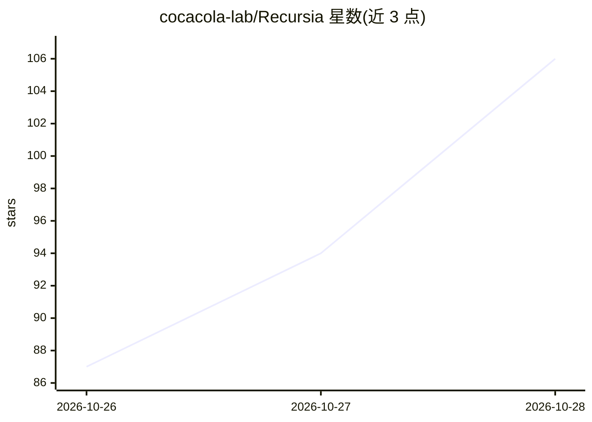

# cocacola-lab/Recursia

⭐ 106 · Python · Apache-2.0 · 推送 2026-10-27 · [GitHub](https://github.com/cocacola-lab/Recursia) · 组织维护

**机器人操作递归自我改进研究代码：真机实验与共享可执行技能**

研究论文配套代码库：在 Franka FR3 机械臂与 Franka Hand 上实现递归自我改进（RSI）方法。机制上从源任务反馈中改进共享的可执行 Python 技能栈，改进以程序形式持久化而非模型权重更新，冻结后的技能栈可复用于新任务组合；附 Skill Document Only（SD-only）基线。仿真代码将加入 recursia/sim/，当前仅提供真机实验部分。安装通过 git clone 加 conda 环境完成，需配置 SAM3 与 Contact-GraspNet 等外部感知/抓取组件后运行。

## 筛选速览

| 维度 | 判定 | 备注 |
|---|---|---|
| AI 角色 | `ai-native` | 本体是模型或模型工具 |
| 许可风险 | `permissive` | Apache-2.0 |
| 部署形态 | `None` |  |
| 模型依赖 | — | README 未给出锁定关系 |
| 硬件要求 | — | 无带数字的原话,不猜 |
| 安装摩擦 | `low` | 无编译、无系统依赖或容器化 |
| 成熟度 | — | 结构信号不足 |

## 能力要点

- 从源任务反馈改进共享可执行 Python 技能栈，改进以程序而非权重更新形式持久化
- 冻结技能栈复用于新任务组合（真机演示含 3 个任务组合）
- Franka FR3 + Franka Hand 真机实验，附 SD-only 基线
- 附真机任务执行视频演示（原始速度与 4x 预览）

## 适用场景

- 复现论文的真机 RSI 机器人操作实验
- 在自建 Franka 工作站上运行递归自我改进流程
- 对比 SD-only 基线评估方法效果

## 场景标签

 · 领域:机器人/具身智能

## 证据(README 行号)

> L5: Recursia improves a shared executable Python stack from source-task feedback,
> L9: This repository currently provides experiments on a Franka FR3 with a Franka

## 星数曲线

2026-10-26 87 → 2026-10-28 106（+19）

---
*卡片 v1 · prompt 1.4 · 生成 2026-10-25 · 置信度 high · 依据 README sha `d51870b80b37` · [字段定义](../../DATASET.md)*
