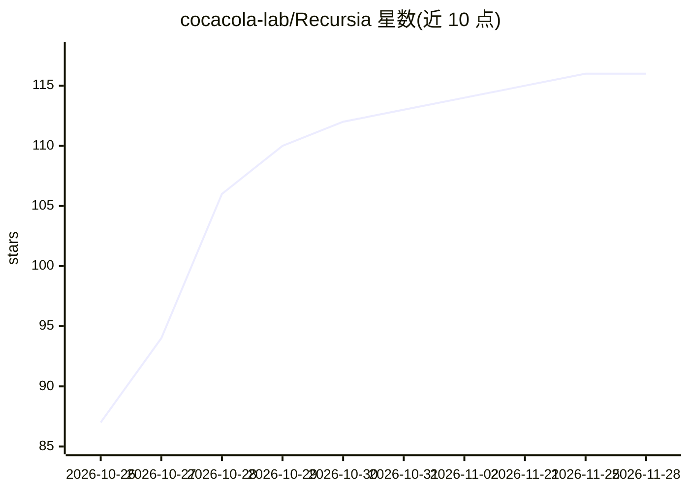

# cocacola-lab/Recursia

⭐ 116 · Python · Apache-2.0 · 推送 2026-10-27 · [GitHub](https://github.com/cocacola-lab/Recursia) · 组织维护

**机器人操作递归自我改进研究代码：真机与仿真实验**

面向机器人操作的递归自我改进（RSI）研究仓库：从源任务反馈改进共享的可执行 Python 技能栈，改进以程序形式持久化而非模型权重更新，随后在新任务组合上复用冻结栈。提供 Franka FR3 + Franka Hand 真机实验（含 SD-only 基线）与 LIBERO-90/LIBERO-Long-Pro 仿真实验；仿真路径可通过 Claude Code 按 CLAUDE.md 自动完成环境搭建与评测。日志、录像、模型权重与站点配置不随仓库分发，SAM3 权重需门控访问。

## 筛选速览

| 维度 | 判定 | 备注 |
|---|---|---|
| AI 角色 | `ai-native` | 本体是模型或模型工具 |
| 许可风险 | `permissive` | Apache-2.0 |
| 部署形态 | `None` |  |
| 模型依赖 | — | README 未给出锁定关系 |
| 硬件要求 | — | 无带数字的原话,不猜 |
| 安装摩擦 | `low` | 无编译、无系统依赖或容器化 |
| 成熟度 | — | 结构信号不足 |

## 能力要点

- 递归自我改进以程序形式持久化，而非模型权重更新
- 真机（Franka FR3）与仿真（LIBERO）双套实验代码
- Claude Code 按 CLAUDE.md 自动搭建仿真环境并运行评测
- 提供规则基线、one-shot 与闭环三种推理评测方式

## 适用场景

- 复现 LIBERO 上的递归自我改进仿真实验
- 在 Franka FR3 工作站上运行真机 RSI 实验
- 研究技能栈复用与零样本长时程操作任务

## 场景标签

`模型评测` `科研工具` · 领域:评测与运维

## 证据(README 行号)

> L5: Recursia improves a shared executable Python stack from source-task feedback,
> L9: This repository provides experiments on a Franka FR3 with a Franka
> L11: experiments under `recursia/sim/`: RSI on LIBERO-90 and zero-shot evaluation on

## 星数曲线

2026-10-26 87 → 2026-11-28 116（+29）

---
*卡片 v1 · prompt 1.4 · 生成 2026-11-28 · 置信度 high · 依据 README sha `eefc4ea5d487` · [字段定义](../../DATASET.md)*
