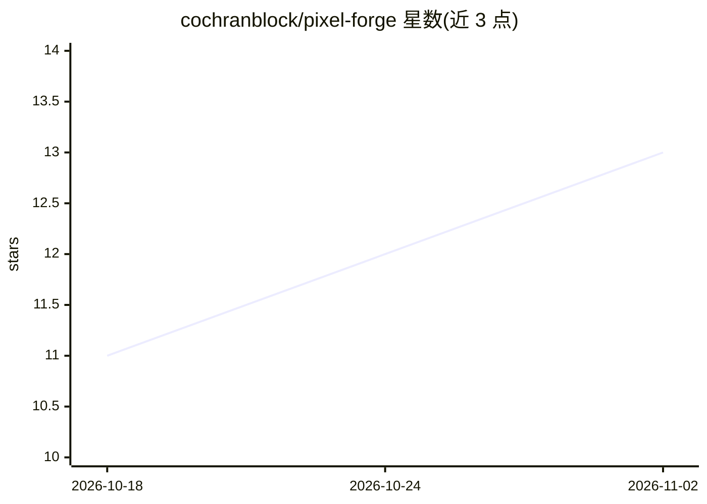

# cochranblock/pixel-forge

⭐ 13 · Rust · Unlicense · 推送 2026-07-22 · [GitHub](https://github.com/cochranblock/pixel-forge) · 个人维护

**生成 32×32 像素风精灵图的 Rust 扩散模型工具**

纯 Rust 实现的像素画精灵生成器，训练并运行 Karras EDM 扩散模型（三档模型，1M–17M 参数），输出 32×32 像素精灵。本地运行于 CPU、Metal（Apple）、CUDA（NVIDIA）或 Vulkan（AMD/Intel），无需 Python、无云端 API。提供 GUI（cargo run 启动）与 CLI（如 anvil character 指定数量/步数/调色板生成），通过 cargo 从源码构建。版本 v0.6.0，Unlicense 公共领域许可，详细文档在仓库根目录的 PROOF_OF_ARTIFACTS.md 等文件中。

## 筛选速览

| 维度 | 判定 | 备注 |
|---|---|---|
| AI 角色 | `ai-native` | 本体是模型或模型工具 |
| 许可风险 | `permissive` | Unlicense |
| 部署形态 | `None` |  |
| 模型依赖 | — | README 未给出锁定关系 |
| 硬件要求 | — | 无带数字的原话,不猜 |
| 安装摩擦 | `high` | 编译与系统依赖俱全 |
| 成熟度 | — | 结构信号不足 |

## 能力要点

- 三档 Karras EDM 扩散模型（1M–17M 参数）生成 32×32 像素精灵
- 纯 Rust 实现，无 Python、无云端 API
- 支持 CPU / Metal / CUDA / Vulkan 多后端本地运行
- 提供 GUI 与 CLI 两种使用方式（可指定步数、调色板）

## 适用场景

- 独立游戏开发中批量生成像素风角色与物品精灵图
- 在本地离线环境（Apple/NVIDIA/AMD GPU）训练并生成像素画素材
- 通过命令行按调色板与步数定制生成结果

## 场景标签

`图像生成` · 领域:内容生成

## 证据(README 行号)

> L14: **Pixel art sprite generator. Three diffusion models. Pure Rust. No cloud.**
> L16: Trains and runs Karras EDM diffusion models that generate 32×32 pixel art sprites. Runs locally on CPU, Metal (Appl

## 星数曲线

2026-10-18 11 → 2026-11-02 13（+2）

---
*卡片 v1 · prompt 1.4 · 生成 2026-11-01 · 置信度 high · 依据 README sha `144d73c3efcb` · [字段定义](../../DATASET.md)*
