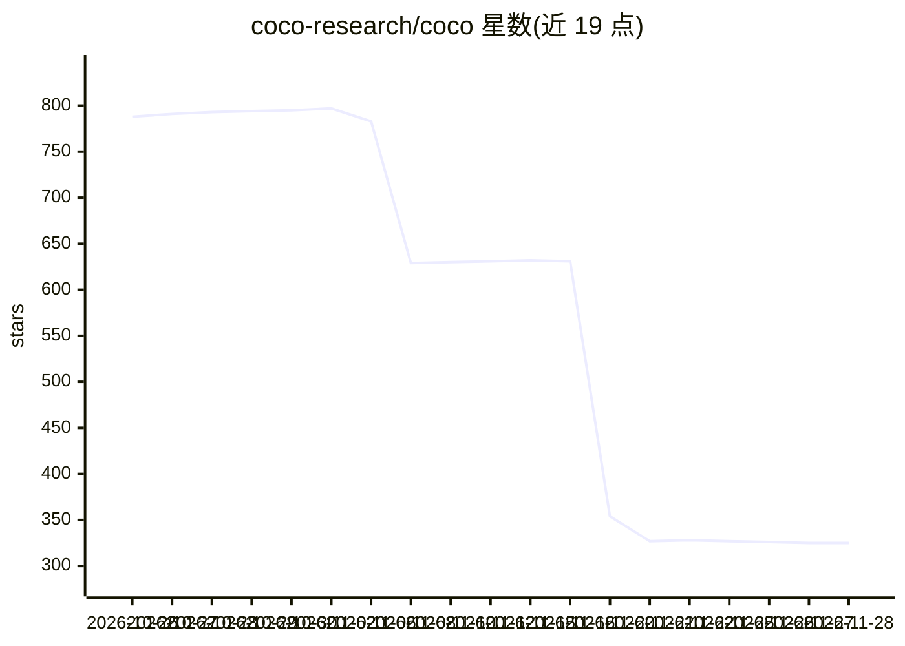

# coco-research/coco

⭐ 325 · Python · Apache-2.0 · 推送 2026-11-27 · [GitHub](https://github.com/coco-research/coco) · [官网](https://cocoresearch.org/coco/) · 组织维护

**为 Claude Code/Cursor/Codex 安装专家面板、技能与命令的工具**

以 npm 包分发的编码代理增强工具：通过一条命令向用户已有的 AI 编码工具（Claude Code、Cursor、Codex、VS Code 等）安装 493 个专家人格、231 个技能与 389 个斜杠命令。核心机制 /SI-Decide 由编排器按领域匹配度等人格 seating 16-32 人组成评审团，返回一个结论并列出具名异议；阶段状态写入磁盘以便 /clear 后延续。文件与状态留在本地，无遥测。前置要求 git、bash、Node.js 14+、python3。

## 筛选速览

| 维度 | 判定 | 备注 |
|---|---|---|
| AI 角色 | `ai-ecosystem` | LLM/agent 周边工具 |
| 许可风险 | `permissive` | Apache-2.0 |
| 部署形态 | `library` | 以包/库形式分发 |
| 模型依赖 | — | README 未给出锁定关系 |
| 硬件要求 | — | 无带数字的原话,不猜 |
| 安装摩擦 | `low` | 无编译、无系统依赖或容器化 |
| 成熟度 | — | 结构信号不足 |

## 能力要点

- 493 个跨 13 部门的专家人格面板，/SI-Decide 返回结论与具名异议
- 231 个技能、389 个斜杠命令，一条 npx 命令装进已有编码代理
- 两阶段路由（embed + keyword 降级回退）选取人格，附带评测数据
- MCP server 支持任意 MCP 客户端经 stdio 接入

## 适用场景

- 在编码会话中对技术决策获得多人格评审与异议记录
- 为 Claude Code / Cursor 批量安装技能与斜杠命令
- 决策后继续用技能完成规划、评审与 PR 流程

## 场景标签

`提示工程` `编码 Agent` · 领域:Agent 开发

## 证据(README 行号)

> L5: Agent skills, slash commands and subagents for Claude Code, Cursor, Codex and other AI coding agents. One command in
> L24: A hard call in a coding session usually gets one model's opinion, with no name on it and no record of who disagreed
> L72: - Install into Claude Code, Cursor, Codex, VS Code, or another adapter. Your model and your keys stay yours.

## 星数曲线

2026-10-26 788 → 2026-11-28 325（-463）

---
*卡片 v1 · prompt 1.4 · 生成 2026-11-27 · 置信度 high · 依据 README sha `aaaa1cf134fd` · [字段定义](../../DATASET.md)*
