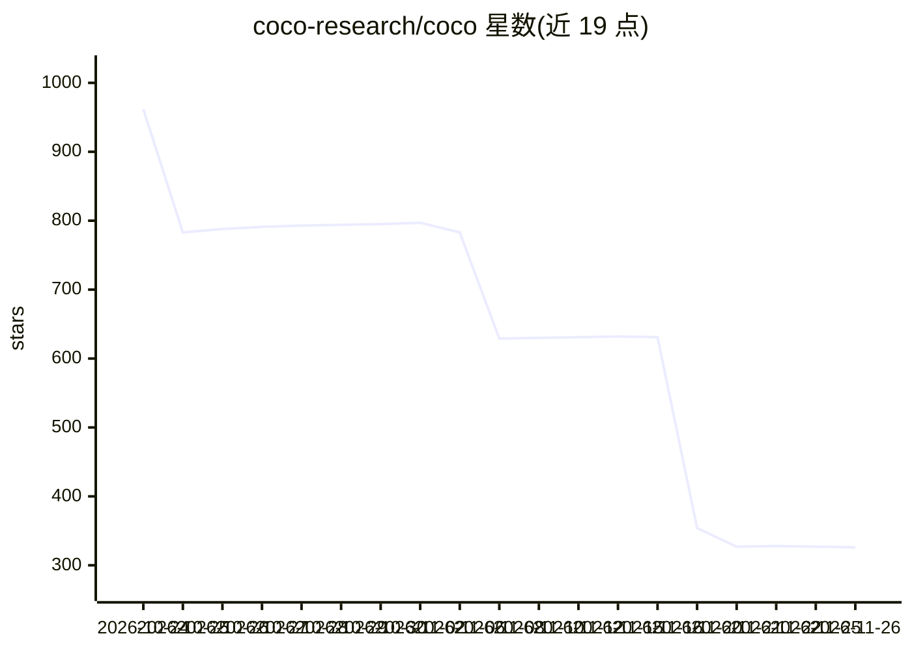

# coco-research/coco

⭐ 326 · Python · Apache-2.0 · 推送 2026-11-25 · [GitHub](https://github.com/coco-research/coco) · [官网](https://cocoresearch.org/coco/) · 组织维护

**给 Claude Code/Cursor/Codex 用户一键安装专家人格董事会、技能与斜杠命令**

面向已有 AI 编码代理的用户，安装 495 个专家人格、231 个技能和 389 个斜杠命令到 Claude Code、Cursor、Codex 等工具中。核心机制是 /SI-Decide：编排器按领域匹配度从 13 个部门的人格中选出 16-32 个，基于引用的公开立场作答，返回一个裁决并列名异议；阶段状态写入磁盘使 /clear 后可延续。文件与状态保留在本地，无遥测，模型与密钥仍归用户自己的 provider。前置依赖 git、bash、Node.js 14+、python3。核心为 Apache-2.0，Super Intelligence 部分为专有许可。

## 筛选速览

| 维度 | 判定 | 备注 |
|---|---|---|
| AI 角色 | `ai-ecosystem` | LLM/agent 周边工具 |
| 许可风险 | `permissive` | Apache-2.0 |
| 部署形态 | `library` | 以包/库形式分发 |
| 模型依赖 | — | README 未给出锁定关系 |
| 硬件要求 | — | 无带数字的原话,不猜 |
| 安装摩擦 | `low` | 无编译、无系统依赖或容器化 |
| 成熟度 | — | 结构信号不足 |

## 能力要点

- 495 个人格跨 13 个部门，两阶段路由选出 16-32 人组成的评审板
- 389 个斜杠命令在用户机器上于安装时生成，不上传任何内容
- 支持 MCP：任何 MCP 客户端可通过 stdio 连接，无需额外依赖
- 本地学习存储读取近期工作流，最多推荐三条技能建议

## 适用场景

- 在编码会话内对架构/迁移等决策获得带列名异议的多视角裁决
- 为团队生成 PRD、评审、验证等后续工作流命令
- GDPR 合规检查、缓存迁移预演等按部门调用专项命令

## 场景标签

`提示工程` `工作流自动化` · 领域:Agent 开发

## 证据(README 行号)

> L5: Agent skills, slash commands and subagents for Claude Code, Cursor, Codex and other AI coding agents. One command in
> L24: A hard call in a coding session usually gets one model's opinion, with no name on it and no record of who disagreed

## 星数曲线

2026-10-24 962 → 2026-11-26 326（-636）

---
*卡片 v1 · prompt 1.4 · 生成 2026-11-25 · 置信度 high · 依据 README sha `d1278820e6f6` · [字段定义](../../DATASET.md)*
