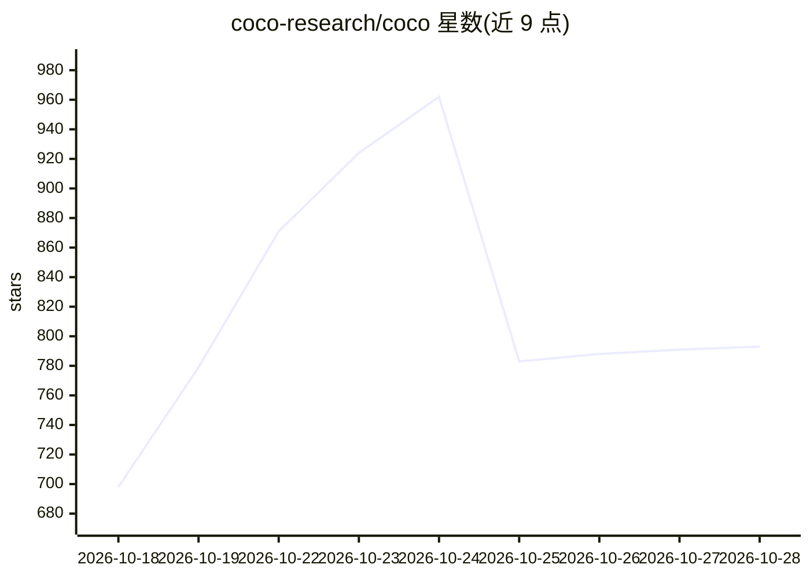

# coco-research/coco

⭐ 794 · Python · NOASSERTION · 推送 2026-10-28 · [GitHub](https://github.com/coco-research/coco) · [官网](https://cocoresearch.org/coco/) · 组织维护

**装进现有编码 Agent 的多专家决策编排层**

安装到 Claude Code、Cursor、Codex、VS Code 等现有编码助手中的编排层：以 495 个基于公开署名专家写作构建的 persona 组成 13 个部门顾问团，/SI-Decide 命令按领域契合度、单元覆盖与建设性冲突评分选出 16-32 人给出决策与具名异议，可加 --debate 轮次。同安装包含 228 个技能、387 个命令（含安装时本地生成的 342 个斜杠命令），并将决策与阶段状态写入磁盘以在 /clear 后保留。核心 MIT 许可，Super Intelligence 部分为专有（open-core），本地运行、无遥测。部分 GSD 技能需上游工具包。

## 筛选速览

| 维度 | 判定 | 备注 |
|---|---|---|
| AI 角色 | `ai-ecosystem` | LLM/agent 周边工具 |
| 许可风险 | `none` | NOASSERTION |
| 部署形态 | `library` | 以包/库形式分发 |
| 模型依赖 | locked-api |  |
| 硬件要求 | — | 无带数字的原话,不猜 |
| 安装摩擦 | `low` | 无编译、无系统依赖或容器化 |
| 成熟度 | — | 结构信号不足 |

## 能力要点

- 495 persona、13 部门、两阶段路由选出 16-32 人顾问团并输出具名异议
- 228 技能与 387 命令，安装时在本地生成 slash 命令
- 决策与阶段状态持久化到磁盘，/clear 后不丢失
- 安装到 Claude Code / Cursor / Codex / VS Code 等适配器，模型与 key 归用户

## 适用场景

- 在编码会话中对架构或产品决策获取多专家意见与异议记录
- 把决策结论带入后续规划、评审与 PR 流程
- 让状态跨会话持久保留以便继续执行计划

## 场景标签

`提示工程` `多智能体` · 领域:Agent 开发

## 证据(README 行号)

> L17: A hard call in a coding session usually gets one model's opinion, with no name on it and no record of who disagreed
> L60: - Install into Claude Code, Cursor, Codex, VS Code, or another adapter. Your model and your keys stay yours.

## 星数曲线

2026-10-18 698 → 2026-10-28 793（+95）

---
*卡片 v1 · prompt 1.4 · 生成 2026-10-21 · 置信度 high · 依据 README sha `3bfd81ad63e0` · [字段定义](../../DATASET.md)*
