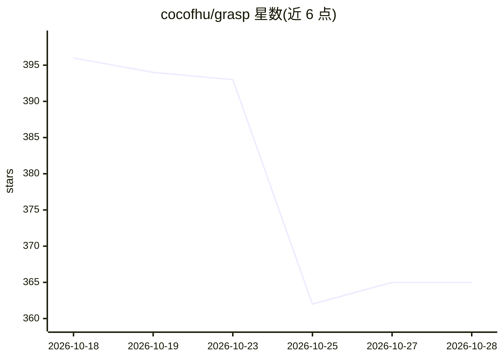

# cocofhu/grasp

⭐ 364 · TypeScript · MIT · 推送 2026-10-28 · [GitHub](https://github.com/cocofhu/grasp) · 个人维护 · 中文 README

**多项目并行编码代理的可视化工作流编排平台**

面向用编码代理开发多个项目的个人开发者：把 Cursor、Claude Code、Codex 等 6 种代理后端接入有限状态机画布，节点含代理、分支与人工审批门；运行前用 clarify agent 多轮问答产出结构化规格与执行计划，代理在隔离 Docker 沙箱中执行并可推送分支或开 PR/MR。Go 后端（FSM 引擎、SQLite、Artifact MCP）+ Vue 前端，经 Docker Compose 部署，提供沙箱日志、noVNC 预览与 token/成本追踪。要求 Linux 主机，本次发布需空数据库全新安装。

## 筛选速览

| 维度 | 判定 | 备注 |
|---|---|---|
| AI 角色 | `ai-ecosystem` | LLM/agent 周边工具 |
| 许可风险 | `permissive` | MIT |
| 部署形态 | `self-host` | docker 或自建部署 |
| 模型依赖 | locked-api |  |
| 硬件要求 | — | 无带数字的原话,不猜 |
| 安装摩擦 | `low` | 无编译、无系统依赖或容器化 |
| 成熟度 | `idea` | |

## 能力要点

- FSM 画布编排 6 种代理后端（Cursor/Claude Code/CodeBuddy/Trae/OpenCode/Codex）
- 人工审批门与统一收件箱，支持一次性分享链接外部审批
- 代理运行于隔离 Docker 沙箱，产出结构化 Artifact 并经 MCP 校验
- 状态时间线、沙箱日志、noVNC 实时预览与 token/成本追踪

## 适用场景

- 在一个工作区管理多个项目并跟踪各代理运行状态
- 为并行编码代理的工作流设置人工审批检查点
- 把代理输出转为结构化产物和可视化预览以便快速审查

## 场景标签

`编码 Agent` `工作流自动化` · 领域:效率与自动化

## 证据(README 行号)

> L29: I built Grasp to manage coding work in one workspace. It wires coding agents into workflows on a finite-state-machi
> L31: Supported agent backends: **Cursor, Claude Code, CodeBuddy, Trae, OpenCode, and Codex**. Each agent step runs insid

## 星数曲线

2026-10-18 396 → 2026-10-28 365（-31）

---
*卡片 v1 · prompt 1.4 · 生成 2026-10-21 · 置信度 high · 依据 README sha `691cb59cefbf` · [字段定义](../../DATASET.md)*
