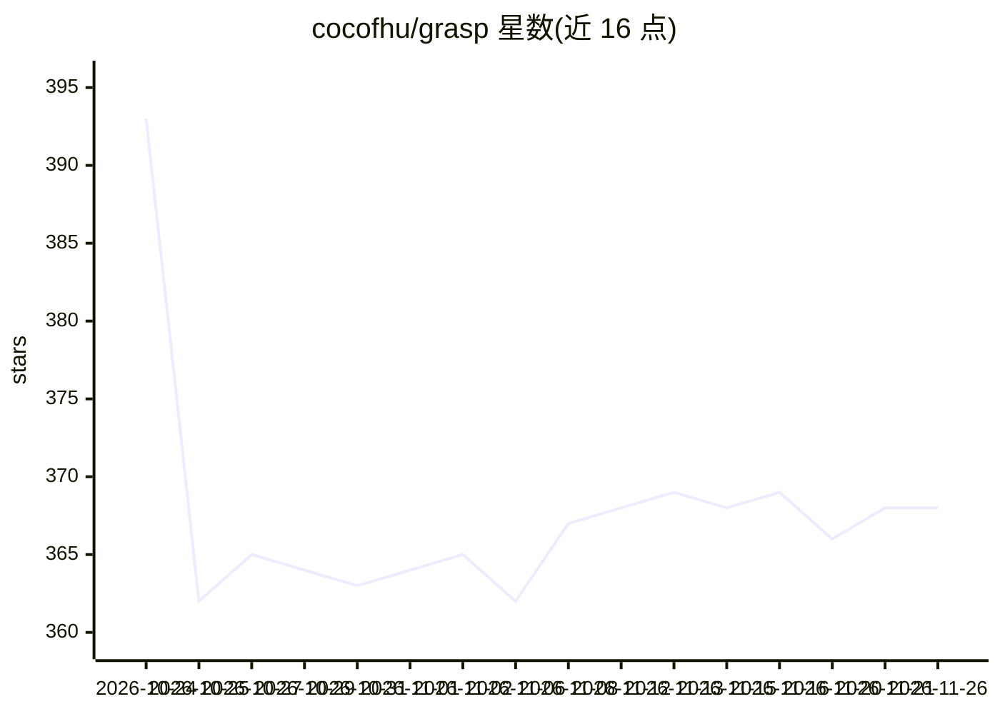

# cocofhu/grasp

⭐ 368 · TypeScript · MIT · 推送 2026-11-25 · [GitHub](https://github.com/cocofhu/grasp) · 个人维护 · 中文 README

**自托管工作区：可视工作流管理多个并行编码 Agent**

自托管的软件交付工作区，用一句话描述任务后可按工作流或 Solo 会话运行编码 Agent。工作流是有限状态机画布上的多步流水线（澄清、实现、测试、人工审批门），失败/回滚边可把任务退回早期节点；Solo 模式为单个 Agent 提供独立沙箱（含 IDE、终端、浏览器）。具体编码工作由 Cursor、Claude Code、Codex 等 8 个 Agent CLI 完成，Grasp 提供画布、Docker/Kubernetes/E2B 沙箱、审批与历史记录，MIT 许可，部署在用户自有基础设施上。

## 筛选速览

| 维度 | 判定 | 备注 |
|---|---|---|
| AI 角色 | `ai-ecosystem` | LLM/agent 周边工具 |
| 许可风险 | `permissive` | MIT |
| 部署形态 | `self-host` | docker 或自建部署 |
| 模型依赖 | — | README 未给出锁定关系 |
| 硬件要求 | — | 无带数字的原话,不猜 |
| 安装摩擦 | `low` | 无编译、无系统依赖或容器化 |
| 成熟度 | `idea` | |

## 能力要点

- FSM 画布工作流：agent、分支、人工门节点，success/failure/rollback 显式边
- 支持 8 个编码 Agent CLI（Cursor、Claude Code、Codex、CodeBuddy、Trae、OpenCode、DeepSeek Harness、Kimi Code）
- Docker/Kubernetes/E2B 沙箱统一经 gateway 管理，空闲沙箱自动保存与释放
- 结构化产物（spec、plan、测试结果、review）经 Artifact MCP 提交并按 run 版本化

## 适用场景

- 用一句话把需求跑成带测试与人工审批的完整 PR 流水线
- 并行管理多个项目的编码 Agent，随时查看各会话停在哪一步
- 团队通过审批门与一次性分享链接审阅 Agent 产出

## 场景标签

`编码 Agent` `多智能体` · 领域:Agent 开发

## 证据(README 行号)

> L35: **Grasp** is a self-hosted workspace for shipping software with coding agents. Describe a task in one sentence and 
> L37: Coding-agent CLIs do the work: **Cursor, Claude Code, Codex, CodeBuddy, Trae, OpenCode, DeepSeek Harness and Kimi C
> L48: |How it runs|The FSM engine walks agent, branch and human-gate nodes along explicit `success` / `failure` / `rollba

## 星数曲线

2026-10-24 393 → 2026-11-26 368（-25）

---
*卡片 v1 · prompt 1.4 · 生成 2026-11-25 · 置信度 high · 依据 README sha `44afc5b159d1` · [字段定义](../../DATASET.md)*
