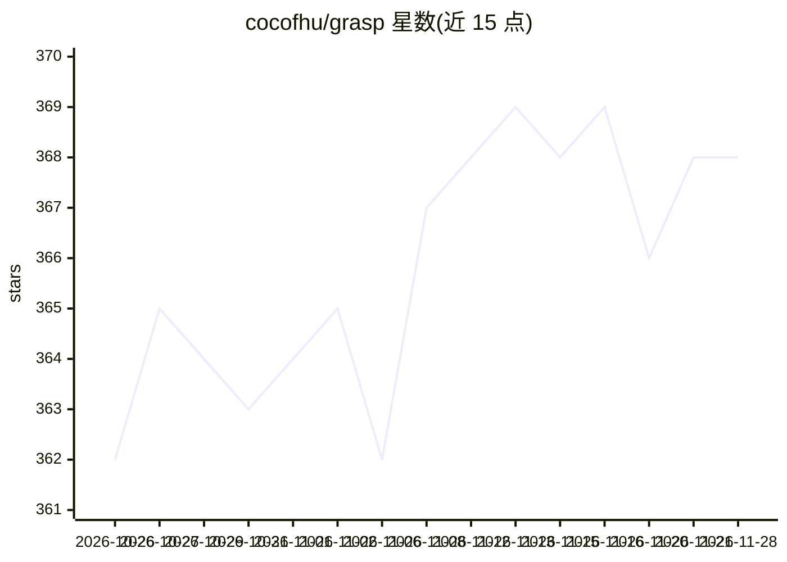

# cocofhu/grasp

⭐ 368 · Go · MIT · 推送 2026-11-27 · [GitHub](https://github.com/cocofhu/grasp) · 个人维护 · 中文 README

**自托管工作区：可视化工作流管理多个编码 agent 与项目**

自托管工作区，用一句话描述任务后以工作流（有限状态机画布上的多步流水线：澄清、实现、测试、人工门禁）或 Solo 会话运行编码 agent。实际执行由 Cursor、Claude Code、Codex 等八种编码 agent CLI 完成，Grasp 提供画布、沙箱（Docker/Kubernetes/E2B）、人工审批与历史记录。架构为 Go 服务器 + Vue 3 前端 + 沙箱网关，以 GHCR 镜像部署在自有基础设施上，MIT 许可，要求 Linux 主机、Git 与 Docker Compose。

## 筛选速览

| 维度 | 判定 | 备注 |
|---|---|---|
| AI 角色 | `ai-ecosystem` | LLM/agent 周边工具 |
| 许可风险 | `permissive` | MIT |
| 部署形态 | `self-host` | docker 或自建部署 |
| 模型依赖 | — | README 未给出锁定关系 |
| 硬件要求 | — | 无带数字的原话,不猜 |
| 安装摩擦 | `low` | 无编译、无系统依赖或容器化 |
| 成熟度 | — | 结构信号不足 |

## 能力要点

- FSM 画布工作流：success/failure/rollback 边、when 守卫、检查点与版本发布
- 八种编码 agent CLI 在 Docker/Kubernetes/E2B 沙箱中运行
- 人工门禁暂停运行，无账号评审者可用一次性分享链接审批
- 结构化工件（spec/计划/测试结果/评审/HTML 预览）版本化保存并按模型统计 token 成本

## 适用场景

- 把可重复的软件开发任务固化成带测试与审批节点的工作流
- 用 Solo 会话在独立沙箱里探索、调试或做一次性修改
- 让 agent 推分支并自动开 PR/MR，由人工在门禁处把关

## 场景标签

`编码 Agent` `工作流自动化` · 领域:效率与自动化

## 证据(README 行号)

> L35: **Grasp** is a self-hosted workspace for shipping software with coding agents. Describe a task in one sentence and 
> L37: Coding-agent CLIs do the work: **Cursor, Claude Code, Codex, CodeBuddy, Trae, OpenCode, DeepSeek Harness and Kimi C

## 星数曲线

2026-10-26 362 → 2026-11-28 368（+6）

---
*卡片 v1 · prompt 1.4 · 生成 2026-11-28 · 置信度 high · 依据 README sha `ddba50f67f9a` · [字段定义](../../DATASET.md)*
