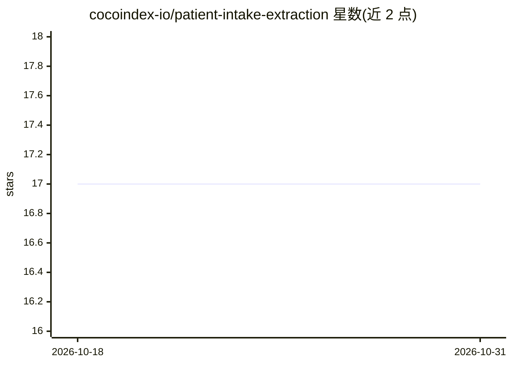

# cocoindex-io/patient-intake-extraction

⭐ 17 · Python · Apache-2.0 · 推送 2026-06-11 · [GitHub](https://github.com/cocoindex-io/patient-intake-extraction) · [官网](https://cocoindex.io) · 组织维护

**从患者登记表 PDF 提取结构化 JSON 的示例应用**

基于 CocoIndex v1 与 DSPy 的医疗表单抽取示例：将每个 PDF 渲染为页面图像，经 Gemini 视觉模型的 ChainOfThought 直接抽取（无中间文本步骤），输出经 Pydantic 校验的 Patient JSON 记录。以文件内容为键做记忆化，重跑只处理变更的表单，删除的表单对应 JSON 自动清理。需 Python 3.11+ 与 Gemini API key，无需 Postgres 与 Docker；data/ 下样例表单为人工构造。

## 筛选速览

| 维度 | 判定 | 备注 |
|---|---|---|
| AI 角色 | `ai-native` | 本体是模型或模型工具 |
| 许可风险 | `permissive` | Apache-2.0 |
| 部署形态 | `library` | 以包/库形式分发 |
| 模型依赖 | — | README 未给出锁定关系 |
| 硬件要求 | — | 无带数字的原话,不猜 |
| 安装摩擦 | `low` | 无编译、无系统依赖或容器化 |
| 成熟度 | — | 结构信号不足 |

## 能力要点

- Pydantic 定义目标 schema，输出类型校验的 Patient JSON
- DSPy ChainOfThought 视觉模块直接从页面图像抽取
- CocoIndex 增量处理：按文件内容记忆化，只重算变更项

## 适用场景

- 把患者登记表 PDF 批量转为结构化 JSON 记录
- 表单更新后增量重跑，仅重处理变更文件
- 作为 CocoIndex 视觉抽取管线的参考实现

## 场景标签

`文档解析` · 领域:知识与检索

## 证据(README 行号)

> L5: Extract structured data from patient intake forms (PDF) using CocoIndex v1 and DSPy with a Gemini vision model. Each
> L12: data/patient_forms/*.pdf  ──▶  pages → images  ──▶  DSPy + Gemini  ──▶  output_patients/*.json
> L16: - **DSPy module** (`main.py`) extracts directly from page images via `ChainOfThought` with vision — no intermediate

## 星数曲线

2026-10-18 17 → 2026-10-31 17（+0）

---
*卡片 v1 · prompt 1.4 · 生成 2026-10-29 · 置信度 high · 依据 README sha `cb234c866cc9` · [字段定义](../../DATASET.md)*
