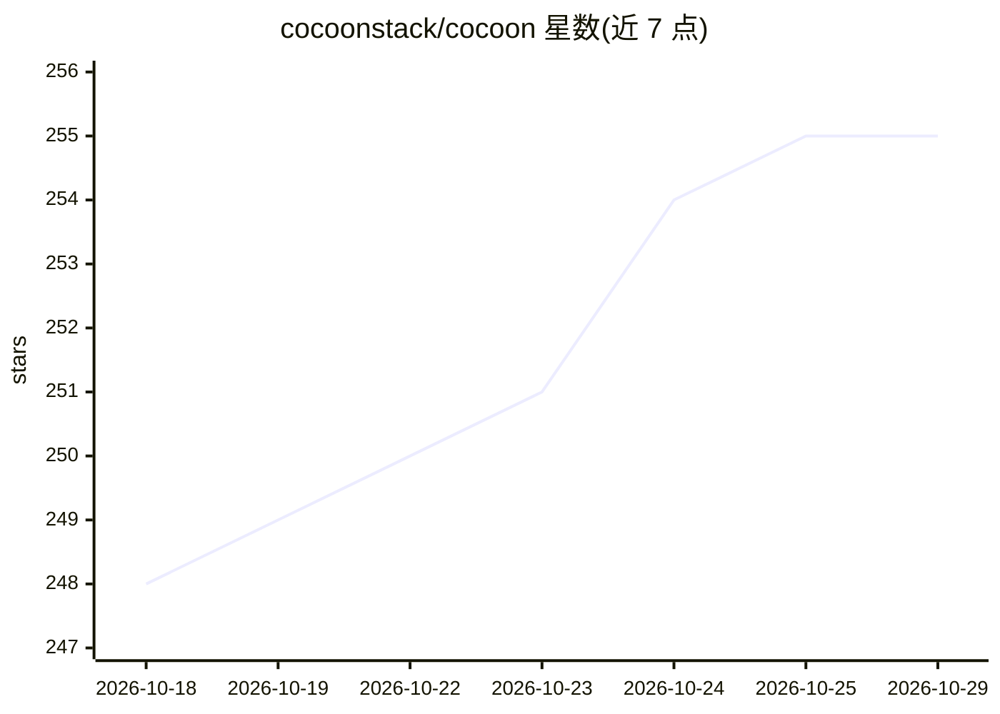

# cocoonstack/cocoon

⭐ 255 · Go · MIT · 推送 2026-10-28 · [GitHub](https://github.com/cocoonstack/cocoon) · [官网](https://cocoonstack.github.io/cocoon/) · 组织维护

**轻量 MicroVM 引擎：为开发者提供 Docker 式虚拟机管理**

基于 Cloud Hypervisor（默认）与 Firecracker 双后端的轻量 MicroVM 管理引擎，提供 Docker 风格 CLI（create/run/clone/exec 等）。核心机制包括：OCI 镜像与云镜像作为 VM 镜像来源、运行中 VM 的快照与克隆（内存写时复制、页缓存共享）、基于 TC redirect 的 CNI 网络、Windows 11 客户机支持、内存气球与巨页、每 VM 一个 hypervisor 进程的无守护架构。以 Linux 二进制（amd64/arm64）发布，适用于 AI 沙箱、云桌面与临时开发环境。

## 筛选速览

| 维度 | 判定 | 备注 |
|---|---|---|
| AI 角色 | `ai-ecosystem` | LLM/agent 周边工具 |
| 许可风险 | `permissive` | MIT |
| 部署形态 | `None` |  |
| 模型依赖 | — | README 未给出锁定关系 |
| 硬件要求 | — | 无带数字的原话,不猜 |
| 安装摩擦 | `low` | 无编译、无系统依赖或容器化 |
| 成熟度 | — | 结构信号不足 |

## 能力要点

- 双 hypervisor 后端：Cloud Hypervisor（默认）与 Firecracker（~125ms 启动，每 VM 开销 <5 MiB）
- OCI 镜像/云镜像拉取作为 VM 镜像，内容寻址 EROFS blob 缓存
- 运行中 VM 快照与克隆：内存写时复制、共享页缓存、原子休眠恢复、跨主机导入导出
- CNI 网络（TC redirect、多 NIC、NIC 热调整）与 vhost-user-fs / VFIO 热插拔

## 适用场景

- 为 AI agent 任务创建隔离的一次性沙箱环境
- 快速克隆运行中的 VM 做并行实验或部署
- 搭建云桌面或标准化开发环境

## 场景标签

 · 领域:虚拟化/云原生基础设施

## 证据(README 行号)

> L3: Lightweight MicroVM engine with dual hypervisor backends: Cloud Hypervisor (default) and Firecracker.
> L10: - **Docker-like CLI** — `create`, `run`, `start`, `stop`, `list`, `inspect`, `console`, `exec`, `rm`, `clone`, `sta
> L11: - **Snapshot & clone** — capture a running VM (memory, disks, config) and clone it into new VMs with fresh network 

## 星数曲线

2026-10-18 248 → 2026-10-29 255（+7）

---
*卡片 v1 · prompt 1.4 · 生成 2026-10-22 · 置信度 mid · 依据 README sha `f3ebd0250277` · [字段定义](../../DATASET.md)*
