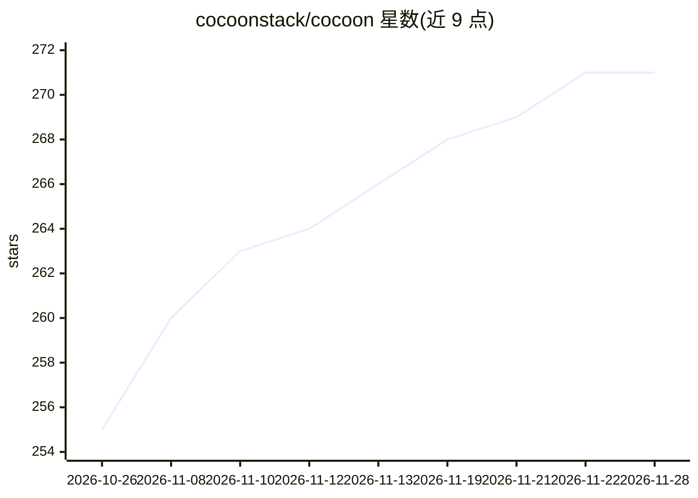

# cocoonstack/cocoon

⭐ 271 · Go · MIT · 推送 2026-11-27 · [GitHub](https://github.com/cocoonstack/cocoon) · [官网](https://cocoonstack.github.io/cocoon/) · 组织维护

**面向开发者的轻量 MicroVM 引擎，支持 AI 沙箱等场景**

基于 Cloud Hypervisor（默认）与 Firecracker 双后端的 MicroVM 引擎，提供类 Docker 的 CLI（create/run/clone/exec 等）。功能包括 OCI 镜像与云镜像拉取、运行中 VM 的快照与 reflink 克隆、跨节点热迁移、CNI 网络（TC redirect）、内存 balloon、hugepages、Windows 11 客户机支持。以 Linux 二进制发布，也可通过 make 从源码构建。描述中目标用途为 AI 沙箱、云桌面与临时环境。

## 筛选速览

| 维度 | 判定 | 备注 |
|---|---|---|
| AI 角色 | `ai-ecosystem` | LLM/agent 周边工具 |
| 许可风险 | `permissive` | MIT |
| 部署形态 | `None` |  |
| 模型依赖 | — | README 未给出锁定关系 |
| 硬件要求 | — | 无带数字的原话,不猜 |
| 安装摩擦 | `low` | 无编译、无系统依赖或容器化 |
| 成熟度 | — | 结构信号不足 |

## 能力要点

- 双 hypervisor 后端：Cloud Hypervisor（默认）与 Firecracker（--fc）
- 运行中 VM 快照与克隆，克隆默认写时复制恢复内存
- OCI 与云镜像支持，内容寻址 EROFS blob 缓存
- CNI 网络经 TC redirect 接线，支持多 NIC 与热调整

## 适用场景

- 为运行不可信代码或 AI agent 搭建隔离沙箱
- 快速克隆开发环境生成多个一次性 VM
- 在本地管理轻量云桌面或临时虚拟机

## 场景标签

 · 领域:云计算/虚拟化基础设施

## 证据(README 行号)

> L3: Lightweight MicroVM engine with dual hypervisor backends: Cloud Hypervisor (default) and Firecracker.
> L10: - **Docker-like CLI** — `create`, `run`, `start`, `stop`, `list`, `inspect`, `console`, `exec`, `rm`, `clone`, `sta

## 星数曲线

2026-10-26 255 → 2026-11-28 271（+16）

---
*卡片 v1 · prompt 1.4 · 生成 2026-11-25 · 置信度 mid · 依据 README sha `06391d963596` · [字段定义](../../DATASET.md)*
