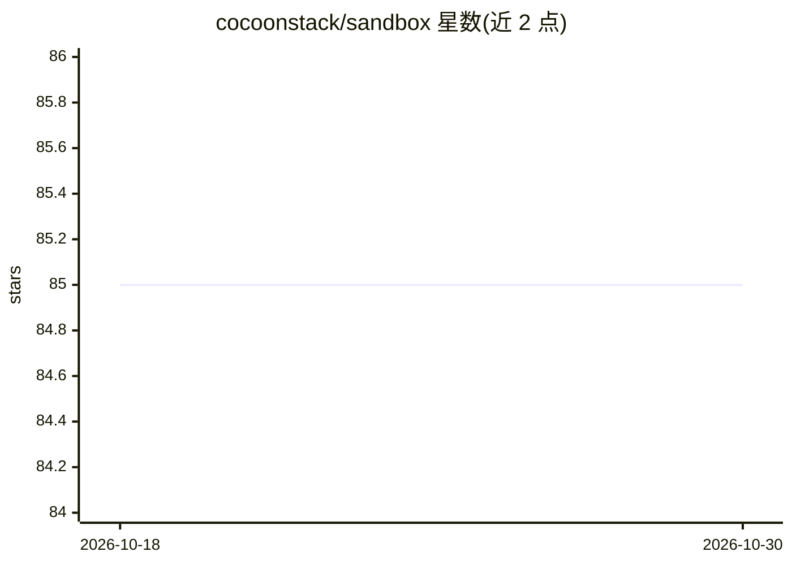

# cocoonstack/sandbox

⭐ 85 · Go · AGPL-3.0 · 推送 2026-10-29 · [GitHub](https://github.com/cocoonstack/sandbox) · [官网](https://cocoonstack.github.io/sandbox/) · 组织维护

**面向 AI agent 的快速冷启动 MicroVM 沙箱运行时**

构建于 cocoon 之上的 MicroVM 沙箱系统：由快速启动 guest 栈、guest 内产品守护进程 silkd、每节点控制面 sandboxd（暖池、金快照克隆、checkpoint/hibernate/fork）及 Go/Python SDK 组成；暖池领取为亚毫秒级，冷启动约 0.2–0.4 秒（裸金属）。提供 MCP stdio 服务器、OpenAI Agents SDK 自定义沙箱 provider 与 LangChain toolkit，供 agent 框架以工具形式执行命令、传文件、开 PTY、端口转发等。默认 net=none 仅 vsock I/O；Python SDK 为 stdlib-only 同步实现，部分管理面仅 Go 可用。仓库为多语言组件（Rust/Go/Python），通过 make 构建与 CI 测试，裸金属 e2e 需真实节点。

## 筛选速览

| 维度 | 判定 | 备注 |
|---|---|---|
| AI 角色 | `ai-ecosystem` | LLM/agent 周边工具 |
| 许可风险 | `viral` | AGPL-3.0 |
| 部署形态 | `self-host` | docker 或自建部署 |
| 模型依赖 | — | README 未给出锁定关系 |
| 硬件要求 | — | 无带数字的原话,不猜 |
| 安装摩擦 | `low` | 无编译、无系统依赖或容器化 |
| 成熟度 | — | 结构信号不足 |

## 能力要点

- 暖池亚毫秒领取、金快照克隆数十毫秒、冷启动约 0.2–0.4 s
- silkd guest 守护进程：exec、持久 shell 会话、流式 fs、PTY、git、端口转发、LSP broker（vsock JSON 帧）
- sandboxd 控制面：claim/release/fork/checkpoint API、memberlist mesh、S3/共享目录 checkpoint 存储、可选 PostgreSQL 元存储
- 提供 MCP 服务器与 OpenAI Agents SDK / LangChain 适配包

## 适用场景

- 为 Claude Code / Cursor / agent 框架提供隔离的代码执行沙箱
- 在集群节点上以暖池方式低延迟领取/回收 agent 执行环境
- 通过 checkpoint/hibernate/fork 管理 agent 会话的执行状态

## 场景标签

 · 领域:AI 基础设施/沙箱运行时

## 证据(README 行号)

> L3: MicroVM sandboxes for AI agents, built on
> L59: - `mcp/` — `sandbox-mcp`, an MCP stdio server exposing the surface as tools
> L61: - `sdk/openai/` — `cocoonstack-sandbox-openai`, a custom sandbox provider

## 星数曲线

2026-10-18 85 → 2026-10-30 85（+0）

---
*卡片 v1 · prompt 1.4 · 生成 2026-10-24 · 置信度 mid · 依据 README sha `797147549877` · [字段定义](../../DATASET.md)*
