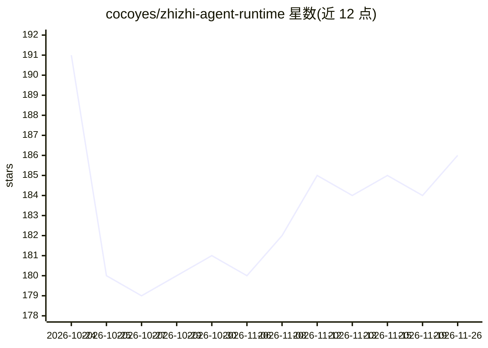

# cocoyes/zhizhi-agent-runtime

⭐ 186 · Go · MIT · 推送 2026-11-01 · [GitHub](https://github.com/cocoyes/zhizhi-agent-runtime) · [官网](https://deepyou.top) · 个人维护 · 中文 README

**给 Go 开发者的智能体运行时框架：模型+工具编排执行**

以 Go 库形式分发的智能体运行时：开发者接入模型端点、把业务函数注册为工具，运行时负责工具调度、预算控制、审批检查点与执行证据。支持对话流式输出、ReAct 工具循环、带依赖图的多步规划与失败重规划、MCP 服务器接入、本地 Skill 目录按需加载，以及经 Docker 一次性容器执行已批准的 Python 脚本。要求 Go 1.25+ 与支持工具调用的模型；Docker 仅 Skill 脚本执行需要。

## 筛选速览

| 维度 | 判定 | 备注 |
|---|---|---|
| AI 角色 | `ai-ecosystem` | LLM/agent 周边工具 |
| 许可风险 | `permissive` | MIT |
| 部署形态 | `self-host` | docker 或自建部署 |
| 模型依赖 | — | README 未给出锁定关系 |
| 硬件要求 | — | 无带数字的原话,不猜 |
| 安装摩擦 | `low` | 无编译、无系统依赖或容器化 |
| 成熟度 | — | 结构信号不足 |

## 能力要点

- 复杂模式构建依赖图，独立步骤并行执行并可在预算内重规划
- 按能力选择 MCP 服务器，Skill 指令按需加载而非全量注入
- WithBudget 限制步数/模型调用/工具调用/超时，含副作用声明与审批恢复
- 响应附带 Evidence/Actions/执行统计，支持 JSONL 与 OpenTelemetry 观测

## 适用场景

- 在 Go 服务中构建带工具调用的对话助手
- 编排带依赖关系的多步任务自动化流程
- 接入多个 MCP 服务器并按能力选择工具
- 在受控容器中运行经审批的 Skill 脚本

## 场景标签

`Agent 框架` · 领域:Agent 开发

## 证据(README 行号)

> L11: Zhizhi (知枝) is a Go runtime for building AI Agents. Connect a model, register your business functions as tools, and
> L13: Use it inside a Go service, assistant, or automation application. You supply the model and business integrations; Z

## 星数曲线

2026-10-24 191 → 2026-11-26 186（-5）

---
*卡片 v1 · prompt 1.4 · 生成 2026-11-26 · 置信度 mid · 依据 README sha `26d667a5c295` · [字段定义](../../DATASET.md)*
