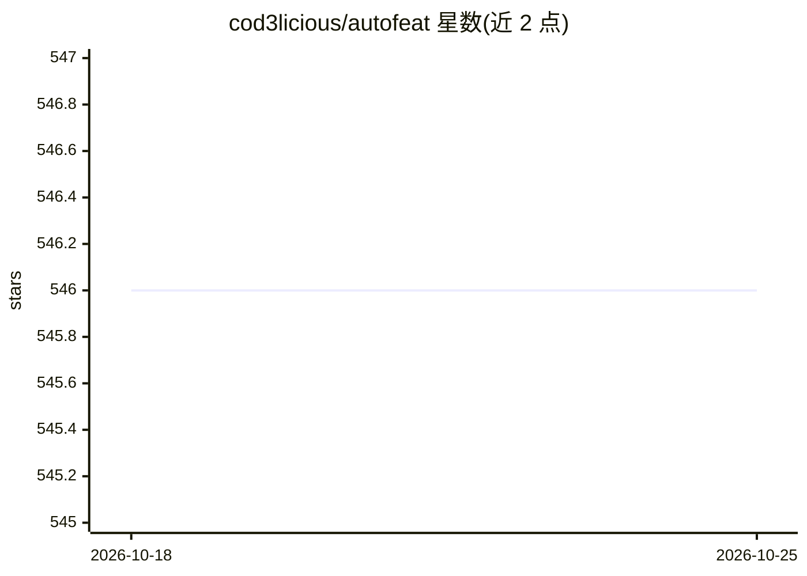

# cod3licious/autofeat

⭐ 546 · Python · MIT · 推送 2026-01-06 · [GitHub](https://github.com/cod3licious/autofeat) · 个人维护

**Python 库：为线性模型自动生成与筛选非线性特征**

提供 sklearn 兼容的线性预测模型，自动化特征工程与特征选择：先从原始数据生成大量非线性特征，再筛选出小规模、稳健且有意义的特征子集以提升线性模型的预测能力，同时保持线性模型的可解释性。可嵌入 scikit-learn pipeline。README 声明代码面向研究用途，结果因数据集与场景而异。依赖 numpy、pandas、scikit-learn、sympy 等。附有论文引用条目。

## 筛选速览

| 维度 | 判定 | 备注 |
|---|---|---|
| AI 角色 | `ai-native` | 本体是模型或模型工具 |
| 许可风险 | `permissive` | MIT |
| 部署形态 | `library` | 以包/库形式分发 |
| 模型依赖 | — | README 未给出锁定关系 |
| 硬件要求 | — | 无带数字的原话,不猜 |
| 安装摩擦 | `low` | 无编译、无系统依赖或容器化 |
| 成熟度 | — | 结构信号不足 |

## 能力要点

- 自动生成非线性特征并筛选小规模稳健子集
- 与 scikit-learn pipeline 完全兼容
- 在提升预测能力的同时保留线性模型可解释性

## 适用场景

- 需要模型透明可解释的监督学习任务
- 大数据集中自动发现重要变量做特征选择
- 在不复杂化模型的前提下利用非线性特征

## 场景标签

 · 领域:机器学习/数据科学

## 证据(README 行号)

> L3: **Autofeat** is a Python library that provides `sklearn`-compatible linear prediction models with automated feature 
> L7: Autofeat simplifies the process of improving linear model performance by automating feature generation and selection

## 星数曲线

2026-10-18 546 → 2026-10-25 546（+0）

---
*卡片 v1 · prompt 1.4 · 生成 2026-10-21 · 置信度 high · 依据 README sha `5325b68a7f24` · [字段定义](../../DATASET.md)*
