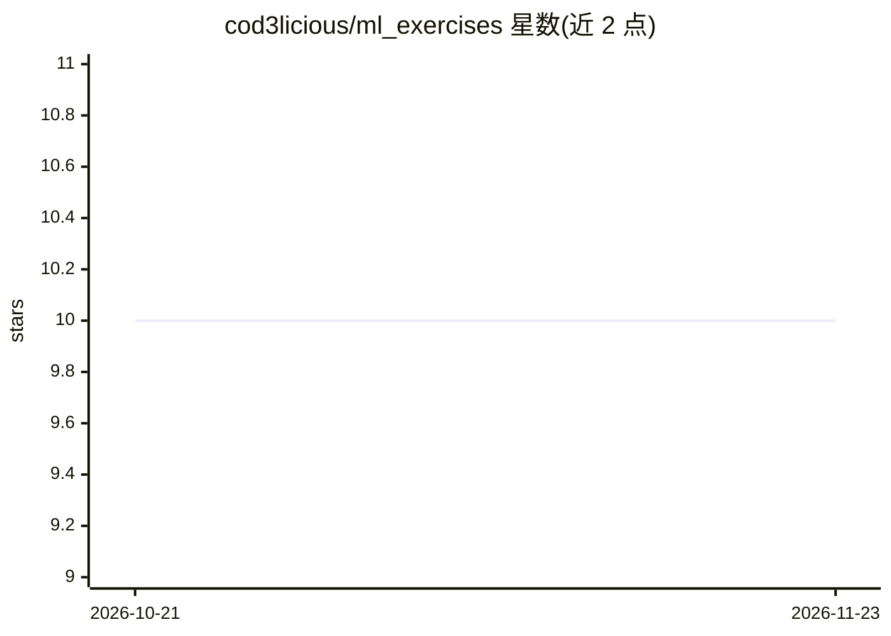

# cod3licious/ml_exercises

⭐ 10 · Jupyter Notebook · 推送 2025-12-15 · [GitHub](https://github.com/cod3licious/ml_exercises) · [官网](https://franziskahorn.de/mlbook/) · 个人维护

**机器学习图书配套的 Python 编程练习集**

作者机器学习教材配套的 Python 编程练习仓库，属于 ML for Data Scientists 与 ML in Practice 两套工作坊课程内容。以 Jupyter Notebook 形式组织，依赖 requirements.txt 中的 Python 库，notebook 6 需额外安装 torch/torchvision/skorch 或 tensorflow。提供三种运行途径：本地安装 Python 3 与 Jupyter、MyBinder 云环境（存在内存不足导致崩溃的可能）、Google Colab（可选 GPU，需手动选择）。

## 筛选速览

| 维度 | 判定 | 备注 |
|---|---|---|
| AI 角色 | `ai-knowledge` | 知识聚合/清单类 |
| 许可风险 | `none` | — |
| 部署形态 | `library` | 以包/库形式分发 |
| 模型依赖 | — | README 未给出锁定关系 |
| 硬件要求 | — | 无带数字的原话,不猜 |
| 安装摩擦 | `low` | 无编译、无系统依赖或容器化 |
| 成熟度 | — | 结构信号不足 |

## 能力要点

- 配套 ML 教材与工作坊课程的 Python 练习
- requirements.txt + test_installation.ipynb 验证依赖环境
- 支持本地、MyBinder、Google Colab 三种运行环境
- notebook 6 需额外安装 torch/torchvision/skorch 或 tensorflow

## 适用场景

- 跟随作者机器学习教材完成配套编程练习
- 参加 ML for Data Scientists / ML in Practice 工作坊的课前准备
- 在 Colab 上零本地环境跑通练习 notebook

## 场景标签

`教程课程` · 领域:学习与行业

## 证据(README 行号)

> L3: This repository contains the Python programming exercises accompanying the theory from my machine learning book. The
> L11: The programming exercises are written in Python. If you're unfamiliar with Python, you should work through this tut
> L24: The easiest way to run the notebooks is using MyBinder:

## 星数曲线

2026-10-21 10 → 2026-11-23 10（+0）

---
*卡片 v1 · prompt 1.4 · 生成 2026-11-19 · 置信度 mid · 依据 README sha `ab1f9825772b` · [字段定义](../../DATASET.md)*
