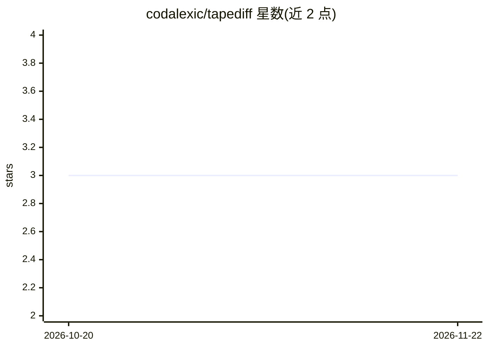

# codalexic/tapediff

⭐ 3 · TypeScript · MIT · 推送 2026-10-09 · [GitHub](https://github.com/codalexic/tapediff) · [官网](https://www.npmjs.com/package/tapediff) · 个人维护

**AI agent 流量快照测试工具：录制、回放与对比 LLM 调用**

一个 Node.js CLI 工具，通过本地回环 HTTP 代理拦截 agent 进程的 LLM 请求：record 模式将请求/响应（含 SSE 流）写为脱敏 JSONL tape，replay 模式离线匹配并返回已录制响应，无需 provider key；diff 对比两次运行捕获行为变化，test 模式在 CI 中对基线 tape 重放并在行为漂移时以退出码 1 失败。要求 Node.js ≥20，支持 OpenAI 与 Anthropic 官方 SDK 的环境变量 baseURL，无 HTTPS MITM，不支持无兼容接口的 provider。

## 筛选速览

| 维度 | 判定 | 备注 |
|---|---|---|
| AI 角色 | `ai-ecosystem` | LLM/agent 周边工具 |
| 许可风险 | `permissive` | MIT |
| 部署形态 | `library` | 以包/库形式分发 |
| 模型依赖 | — | README 未给出锁定关系 |
| 硬件要求 | — | 无带数字的原话,不猜 |
| 安装摩擦 | `low` | 无编译、无系统依赖或容器化 |
| 成熟度 | — | 结构信号不足 |

## 能力要点

- 回环代理拦截方式，官方 OpenAI/Anthropic SDK 无需改代码即可录制
- 回放不请求 provider，支持 SSE 流式响应
- diff 检测行为变化并在 CI 中使测试失败，CI 无需 API key
- tape 为脱敏 JSONL 格式，可用 show 命令查看输入/工具调用/最终答案

## 适用场景

- 改了 prompt 后检查 agent 的工具调用是否产生回归
- 在 CI 中用已审查的基线 tape 做快照测试，不花真实 API 费用
- 本地离线调试 agent 而不请求真实 provider

## 场景标签

`模型评测` `LLM 可观测性` · 领域:评测与运维

## 证据(README 行号)

> L7: **Snapshot testing for AI agents.**
> L58: tapediff starts a loopback HTTP proxy and points the child process's SDK base
> L109: LangChain and LlamaIndex haven't been tried yet, but should work since they use

## 星数曲线

2026-10-20 3 → 2026-11-22 3（+0）

---
*卡片 v1 · prompt 1.4 · 生成 2026-11-22 · 置信度 mid · 依据 README sha `c46dca9fb413` · [字段定义](../../DATASET.md)*
