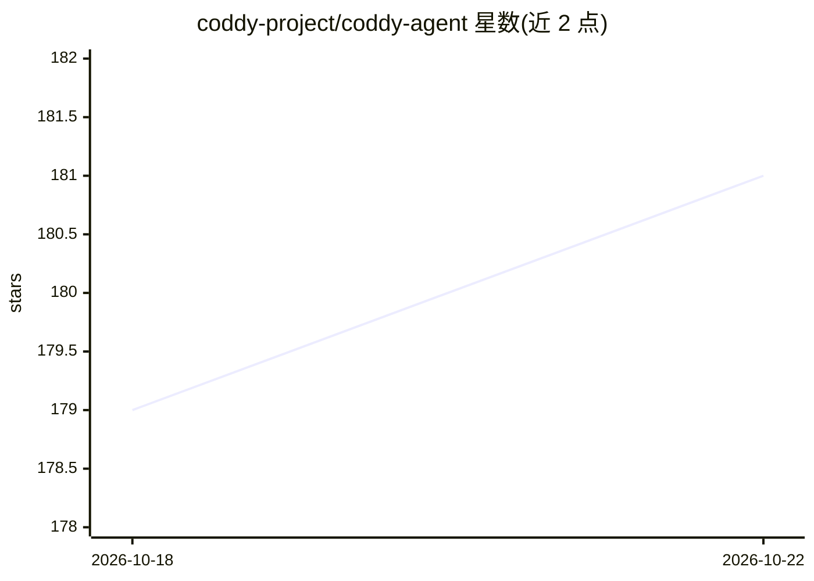

# coddy-project/coddy-agent

⭐ 181 · Go · MIT · 推送 2026-10-21 · [GitHub](https://github.com/coddy-project/coddy-agent) · [官网](https://coddy.dev) · 组织维护

**单二进制通用 AI agent：终端/编辑器/浏览器/Telegram 多端接入**

Go 编写的单静态二进制通用 agent 框架（harness），同一 agent 核心可通过控制台 TUI、编辑器 ACP 服务、内嵌 Web UI 与 OpenAI 兼容 HTTP API、Telegram/Pachca 网关、cron 调度器及 swarm 中继访问，会话跨界面共享于 ~/.coddy。功能含规则、技能（SKILL.md）、子代理、hooks、MCP、后台任务、长期记忆、上下文压缩、git worktree 管理等。支持 OpenAI、Anthropic、Ollama、llama.cpp、vLLM 等多种模型来源。安装提供脚本、.deb/.rpm、Homebrew、Docker 镜像与源码构建。

## 筛选速览

| 维度 | 判定 | 备注 |
|---|---|---|
| AI 角色 | `ai-ecosystem` | LLM/agent 周边工具 |
| 许可风险 | `permissive` | MIT |
| 部署形态 | `self-host` | docker 或自建部署 |
| 模型依赖 | local-ok | 支持本地模型 |
| 硬件要求 | — | 无带数字的原话,不猜 |
| 安装摩擦 | `low` | 无编译、无系统依赖或容器化 |
| 成熟度 | — | 结构信号不足 |

## 能力要点

- 一个静态 Go 二进制覆盖 TUI/ACP/HTTP API/Telegram/调度器/swarm 七种接入面，会话共享
- ReAct 循环 + MCP、规则、技能、子代理、hooks、长期记忆与上下文压缩
- 任意 OpenAI 兼容后端，含 Ollama/llama.cpp/vLLM 与 ACP agent 充当模型
- distroless/scratch 容器运行，只读根文件系统，无需运行时依赖

## 适用场景

- 在终端、编辑器和浏览器中用同一会话继续对话
- 通过 Telegram 机器人访问个人 agent
- 用 cron 定时任务和 swarm 中继管理多节点 agent 集群
- 在本地 Ollama/llama.cpp 上跑日常编码与自动化任务

## 场景标签

`Agent 框架` `Agent 记忆` `编码 Agent` `AI 助手` · 领域:Agent 开发

## 证据(README 行号)

> L9:  A general-purpose agent in one static Go binary.
> L19: Coddy is a **harness**: the same agent core is reachable from a terminal through the console TUI, from an editor ov
> L86: - **Any model**: OpenAI, Anthropic, NeuralDeep, ChatGPT through Codex, the models of a Devin account (Devin), a loc

## 星数曲线

2026-10-18 179 → 2026-10-22 181（+2）

---
*卡片 v1 · prompt 1.4 · 生成 2026-10-22 · 置信度 high · 依据 README sha `e6c6378ebca8` · [字段定义](../../DATASET.md)*
