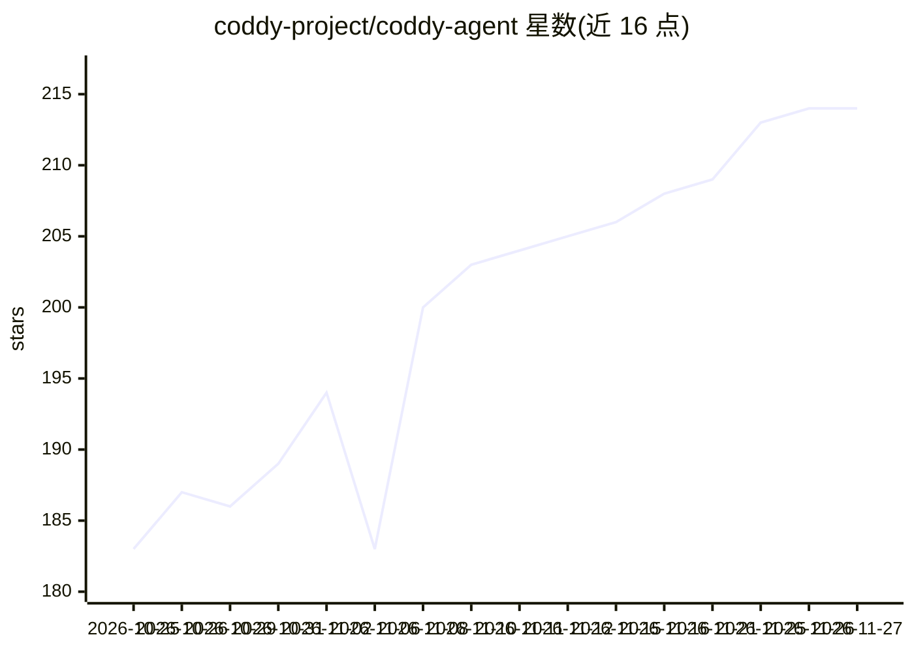

# coddy-project/coddy-agent

⭐ 214 · Go · MIT · 推送 2026-11-26 · [GitHub](https://github.com/coddy-project/coddy-agent) · [官网](https://coddy.dev) · 组织维护

**单静态 Go 二进制的通用 agent，多界面共享同一会话**

以单一静态 Go 二进制分发：同一 agent 核心可通过桌面应用、终端 TUI、编辑器（ACP）、内嵌 Web UI 与 OpenAI 兼容 HTTP API、Telegram/Pachca 网关、cron 调度器、swarm relay 和 remote 模式访问，各界面共享 ~/.coddy 下的会话。机制包括 ReAct 循环、文件/shell 工具、MCP、rules、skills、子代理、hooks、后台任务、长期记忆、上下文压缩与项目信任门。可运行于 scratch/distroless 只读根文件系统镜像，无运行时依赖。MIT 许可，提供多平台安装包。

## 筛选速览

| 维度 | 判定 | 备注 |
|---|---|---|
| AI 角色 | `ai-ecosystem` | LLM/agent 周边工具 |
| 许可风险 | `permissive` | MIT |
| 部署形态 | `self-host` | docker 或自建部署 |
| 模型依赖 | local-ok | 支持本地模型 |
| 硬件要求 | — | 无带数字的原话,不猜 |
| 安装摩擦 | `low` | 无编译、无系统依赖或容器化 |
| 成熟度 | — | 结构信号不足 |

## 能力要点

- 一个静态二进制覆盖桌面、终端、编辑器、浏览器、Telegram 等多种界面，共享同一会话
- OpenAI 兼容 API 与内嵌 Web UI、Swagger 文档
- 子代理、skills（SKILL.md 斜杠命令）、hooks、MCP 与上下文压缩
- Swarm relay 管理多节点舰队并支持 Prometheus 指标导出

## 适用场景

- 在终端、编辑器与手机浏览器间续接同一个 agent 会话
- 通过 Telegram 机器人远程驱动本机 agent
- 用 cron 定时任务以 Markdown 文件形式编排 agent 运行
- 对容器集群中的多节点 agent 做统一管理与监控

## 场景标签

`AI 助手` `多智能体` · 领域:Agent 开发

## 证据(README 行号)

> L9:  A general-purpose agent in one static Go binary.
> L19: Coddy is a **harness**: the same agent core is reachable from the desktop app with `coddy desktop`, from a terminal

## 星数曲线

2026-10-25 183 → 2026-11-27 214（+31）

---
*卡片 v1 · prompt 1.4 · 生成 2026-11-25 · 置信度 high · 依据 README sha `9388a6d03959` · [字段定义](../../DATASET.md)*
