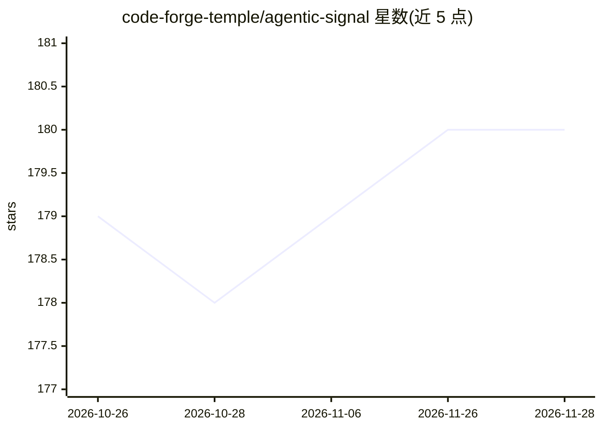

# code-forge-temple/agentic-signal

⭐ 180 · TypeScript · NOASSERTION · 推送 2026-11-15 · [GitHub](https://github.com/code-forge-temple/agentic-signal) · [官网](https://agentic-signal.com) · 个人维护

**可视化 AI agent 工作流自动化平台，本地 LLM 运行、无需云依赖**

基于 React Flow 的拖拽式可视化工作流平台，用节点连接数据源、AI 处理器与输出，实时执行。AI 能力通过 Ollama 本地运行大模型，支持工具调用（天气/搜索/Google 服务/表单填写/网页转 Markdown 等）、JSON schema 结构化输出与跨执行的对话记忆，内置 RAG 与任务搜索等节点。提供 Windows/Linux/macOS 桌面应用与 Web 应用（含 Docker）。采用 AGPL v3 与商业许可双许可模式，商业使用需购买授权；部分集成节点（Slack/Reddit/SMS）标注为 PRO。

## 筛选速览

| 维度 | 判定 | 备注 |
|---|---|---|
| AI 角色 | `ai-ecosystem` | LLM/agent 周边工具 |
| 许可风险 | `none` | NOASSERTION |
| 部署形态 | `None` |  |
| 模型依赖 | local-ok | 支持本地模型 |
| 硬件要求 | — | 无带数字的原话,不猜 |
| 安装摩擦 | `low` | 无编译、无系统依赖或容器化 |
| 成熟度 | — | 结构信号不足 |

## 能力要点

- 拖拽式可视化工作流构建（React Flow 节点架构）
- Ollama 本地模型集成，含工具调用与结构化输出
- 20 余种节点类型：RAG、表单填写、股票分析、Job Search 等
- 提供桌面应用与 Web 应用（含 Docker）两种部署形式

## 适用场景

- 在本地搭建无需云端的 AI 自动化工作流
- 通过浏览器自动化读取、填写并提交多步网页表单
- 连接 Ollama 本地模型做文本分析与生成
- 用可视化节点编排股票分析与图表展示

## 场景标签

`工作流自动化` `浏览器自动化` `RAG` · 领域:效率与自动化

## 证据(README 行号)

> L3: **Visual AI Workflow Automation Platform with Local Agent Intelligence**
> L29: > Transform complex tasks into visual workflows with local AI intelligence. No cloud dependencies required.
> L43: - **Ollama Integration** - Run AI models locally with privacy and control

## 星数曲线

2026-10-26 179 → 2026-11-28 180（+1）

---
*卡片 v1 · prompt 1.4 · 生成 2026-11-26 · 置信度 high · 依据 README sha `c066e90ddc7c` · [字段定义](../../DATASET.md)*
