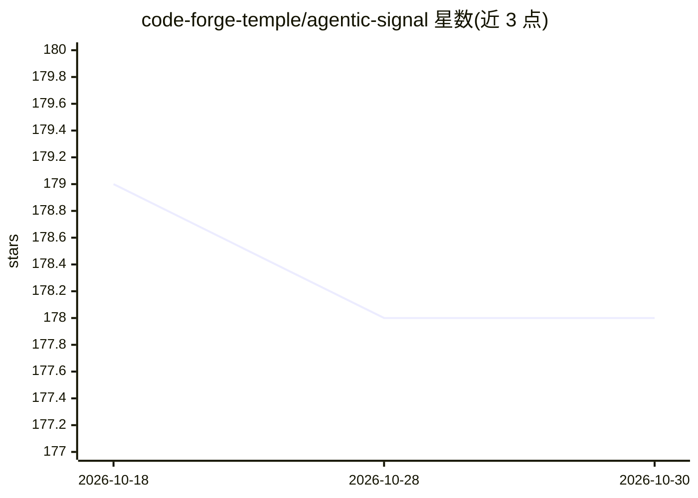

# code-forge-temple/agentic-signal

⭐ 178 · TypeScript · NOASSERTION · 推送 2026-09-28 · [GitHub](https://github.com/code-forge-temple/agentic-signal) · [官网](https://agentic-signal.com) · 个人维护

**给非开发者的可视化 AI 工作流平台，本地 LLM 驱动**

可视化 AI 工作流自动化平台：通过拖拽式节点界面构建数据处理、AI 处理、工具调用、RAG、HTTP 抓取、求职搜索、股票分析等类型的工作流，实时查看数据流动。AI 部分通过集成 Ollama 运行本地语言模型，支持工具调用、JSON schema 结构化输出与对话记忆，无需云依赖。提供 Windows/Linux/macOS 桌面应用与 Web 应用（含 Docker 选项）；Slack、Reddit、SMS 等节点为 PRO 功能，商业使用需购买商业许可（AGPL v3 双许可模式）。

## 筛选速览

| 维度 | 判定 | 备注 |
|---|---|---|
| AI 角色 | `ai-ecosystem` | LLM/agent 周边工具 |
| 许可风险 | `none` | NOASSERTION |
| 部署形态 | `None` |  |
| 模型依赖 | local-ok | 支持本地模型 |
| 硬件要求 | — | 无带数字的原话,不猜 |
| 安装摩擦 | `low` | 无编译、无系统依赖或容器化 |
| 成熟度 | — | 结构信号不足 |

## 能力要点

- React Flow 拖拽式节点工作流构建器，实时执行与数据流可视化
- 通过 Ollama 运行本地 LLM，支持工具调用、结构化输出与对话记忆
- 20+ 节点类型：数据源、AI 处理、RAG、HTTP、求职搜索、表单填写等
- Windows/Linux/macOS 应用与 Web 版（含 Docker 选项）

## 适用场景

- 不写代码搭建带本地 AI 的自动化工作流
- 在离线/隐私优先环境下用本地 LLM 处理数据
- 自动化网页表单填写、网页转 Markdown、数据聚合等任务

## 场景标签

`工作流自动化` · 领域:效率与自动化

## 证据(README 行号)

> L29: > Transform complex tasks into visual workflows with local AI intelligence. No cloud dependencies required.
> L43: - **Ollama Integration** - Run AI models locally with privacy and control

## 星数曲线

2026-10-18 179 → 2026-10-30 178（-1）

---
*卡片 v1 · prompt 1.4 · 生成 2026-10-22 · 置信度 high · 依据 README sha `72475bfb3a18` · [字段定义](../../DATASET.md)*
