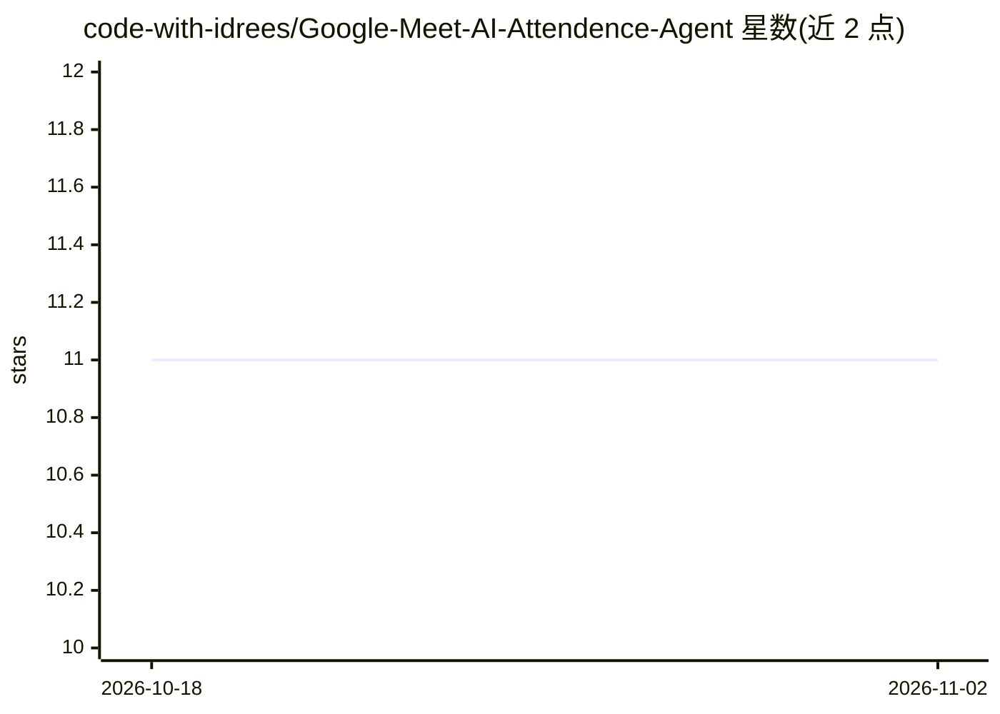

# code-with-idrees/Google-Meet-AI-Attendence-Agent

⭐ 11 · Python · MIT · 推送 2026-03-13 · [GitHub](https://github.com/code-with-idrees/Google-Meet-AI-Attendence-Agent) · 个人维护

**自动加入 Google Meet 上课并应答点名、生成笔记的本地 AI 机器人**

Python 编写的自主机器人，通过 Playwright 控制浏览器加入 Google Meet 会议：用 PulseAudio 捕获系统音频、Faster-Whisper 在 CPU 本地转写，经 4 层关键词引擎检测点名并自动在聊天中回复；非点名问题交给本地 Ollama LLM 以第一人称身份回答。每 60 秒截图并用 Tesseract OCR 提取幻灯片文字，会后由 Ollama 生成结构化 Markdown 学习笔记并导出 txt/PDF。全程本地模型运行，无需云端 API，但仅限 Linux，需配置 Google OAuth2 凭据，且从源码安装、依赖较多系统包。

## 筛选速览

| 维度 | 判定 | 备注 |
|---|---|---|
| AI 角色 | `ai-native` | 本体是模型或模型工具 |
| 许可风险 | `permissive` | MIT |
| 部署形态 | `library` | 以包/库形式分发 |
| 模型依赖 | local-ok | 支持本地模型 |
| 硬件要求 | — | 无带数字的原话,不猜 |
| 安装摩擦 | `medium` | 含编译或系统依赖之一 |
| 成熟度 | — | 结构信号不足 |

## 能力要点

- Faster-Whisper 本地 CPU 转写 + 4 层点名关键词检测（含 Levenshtein 模糊匹配）
- 本地 Ollama LLM 以第一人称身份系统提示回答课堂问题，输出经多层幻觉过滤
- 每 60 秒截图 Tesseract OCR 提取幻灯片文字
- 会后将完整会话日志生成为结构化学习笔记（txt + PDF）

## 适用场景

- 我不方便到场时让机器人替我加入 Google Meet 并应答点名
- 自动记录整堂课的语音转写与幻灯片内容
- 会后自动生成可复习的结构化笔记 PDF

## 场景标签

`浏览器自动化` `语音识别` `OCR` `AI 写作` · 领域:效率与自动化

## 证据(README 行号)

> L16: **Google Meet AI Attendance Agent** is a Python-based autonomous bot that joins your Google Meet sessions on your b
> L31: |🎤 **Live Transcription**|Captures system audio and transcribes with **Faster-Whisper** locally on CPU — no cloud S
> L75: |**AI Brain**|Ollama — local LLM, fully offline|Free / No API key needed|

## 星数曲线

2026-10-18 11 → 2026-11-02 11（+0）

---
*卡片 v1 · prompt 1.4 · 生成 2026-11-02 · 置信度 high · 依据 README sha `58bf4c518ebd` · [字段定义](../../DATASET.md)*
