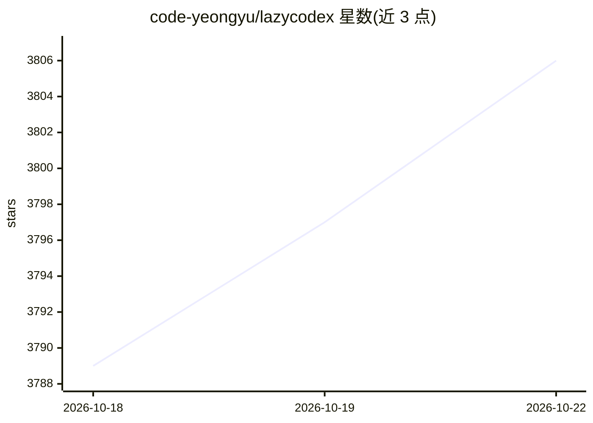

# code-yeongyu/lazycodex

⭐ 3,808 · TypeScript · MIT · 推送 2026-10-22 · [GitHub](https://github.com/code-yeongyu/lazycodex) · [官网](https://lazycodex.ai) · 组织维护

**面向复杂代码库的 Codex agent harness 发行包**

LazyCodex 将 OmO（oh-my-openagent）打包为 Codex 平台的 agent harness 分发层，以 npx 一行命令安装，也可经 Codex 插件市场安装。提供项目记忆（$init-deep 生成层级 AGENTS.md）、规划（$ulw-plan 写计划文件）、执行（$start-work 按清单执行）与验证完成（$ulw-loop 循环至 Oracle 验证，上限 500 次迭代）等命令；附带技能库、子 agent 角色、hooks 与按任务类别的多模型路由（GPT-5.2/5.3-Codex/5.4-mini 等）。核心引擎以 submodule 形式引入，MIT 许可，由 Sisyphus Labs 维护。

## 筛选速览

| 维度 | 判定 | 备注 |
|---|---|---|
| AI 角色 | `ai-ecosystem` | LLM/agent 周边工具 |
| 许可风险 | `permissive` | MIT |
| 部署形态 | `library` | 以包/库形式分发 |
| 模型依赖 | — | README 未给出锁定关系 |
| 硬件要求 | — | 无带数字的原话,不猜 |
| 安装摩擦 | `low` | 无编译、无系统依赖或容器化 |
| 成熟度 | `idea` | |

## 动量与使用信号

- 安装:github 包 `release-assets` 月下载无数据

## 能力要点

- $init-deep 生成层级化 AGENTS.md 项目记忆
- $ulw-loop 循环执行直至 Oracle 验证完成（上限 500 次迭代）
- 多模型路由按任务类别选择 GPT 模型
- 安装 explorer/librarian/plan 等可选子 agent 角色到 ~/.codex/agents/

## 适用场景

- 在 Codex 中为大型仓库建立项目记忆与导航地标
- 先规划再执行的开发流程（$ulw-plan → $start-work）
- 开放任务持续迭代到有证据的验证完成

## 场景标签

`编码 Agent` · 领域:编码与开发

## 证据(README 行号)

> L5:  The one and only agent harness for complex codebases.
> L178: **LazyCodex** packages OmO (oh-my-openagent) as the Codex agent harness for complex codebases.
> L241: LazyCodex is a thin distribution layer. The core engine is oh-my-openagent (OmO), included as a submodule under `s

## 星数曲线

2026-10-18 3,789 → 2026-10-22 3,806（+17）

---
*卡片 v1 · prompt 1.4 · 生成 2026-10-18 · 置信度 high · 依据 README sha `fed27d2dc22f` · [字段定义](../../DATASET.md)*
