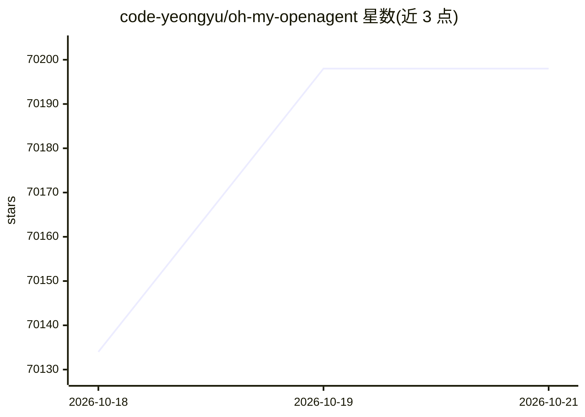

# code-yeongyu/oh-my-openagent

⭐ 70,198 · TypeScript · NOASSERTION · 推送 2026-10-19 · [GitHub](https://github.com/code-yeongyu/oh-my-openagent) · [官网](https://omo.dev) · 个人维护 · 中文 README

**单命令编码 Agent：编排多 Agent 图执行研究与编码任务**

OmO 是一个通过 `omo` 命令运行的终端编码 Agent，运行在自研的 senpi（pi 的 fork）之上。在提示中加入 `ulw` 或 `mass ulw` 可将任务展开为多 Agent 图，各部分在不同模型上并行执行并逐一校验；内置以 git 仓库中 markdown 文件存储的记忆系统、按任务加载的技能、会话恢复（/resume、omo -c）等机制。安装方式为官方安装脚本或 npm/bun 全局包（包名 omo-ai），提供 Windows PowerShell 安装路径。

## 筛选速览

| 维度 | 判定 | 备注 |
|---|---|---|
| AI 角色 | `ai-native` | 本体是模型或模型工具 |
| 许可风险 | `none` | NOASSERTION |
| 部署形态 | `library` | 以包/库形式分发 |
| 模型依赖 | — | README 未给出锁定关系 |
| 硬件要求 | — | 无带数字的原话,不猜 |
| 安装摩擦 | `low` | 无编译、无系统依赖或容器化 |
| 成熟度 | — | 结构信号不足 |

## 动量与使用信号

- 维护:`active` — 距上次 push 0.6 天,年发版 100,330 位贡献者
- 涨星:近 1 天 **+46**(自 20261016 起算)
- 安装:npm 包 `omo-ai` 月下载 37,229
- 平台:WINDOWS · 协议:OPENAI-API / MCP

## 能力要点

- `mass ulw` 关键词将任务展开为多 Agent 图并行执行
- 记忆系统存储于 git 仓库中的 markdown 文件，由辅助模型读取并提示主 Agent
- /login 支持 Claude、ChatGPT、Kimi、GLM 订阅登录，每个模型配套专用系统提示
- 独立工具调用合并执行，支持长任务断点续做与配置热加载

## 适用场景

- 在终端中用自然语言描述任务并让 Agent 完成编码
- 跨数千来源的深度研究与 ML 流水线类批量任务
- 从 OpenCode 或 LazyCodex 迁移现有配置（omo setup）

## 场景标签

`编码 Agent` `多智能体` · 领域:Agent 开发

## 证据(README 行号)

> L40: OmO is one `omo` command that turns your tokens into finished work: research across ten thousand sources, a deck pe
> L65: **Hundreds of agents, one keyword.** Type `mass ulw` and the whole job becomes a graph of agents: deep research ove

## 星数曲线

2026-10-18 70,134 → 2026-10-21 70,198（+64）

---
*卡片 v1 · prompt 1.4 · 生成 2026-10-18 · 置信度 high · 依据 README sha `fb3ead2df9d4` · [字段定义](../../DATASET.md)*
