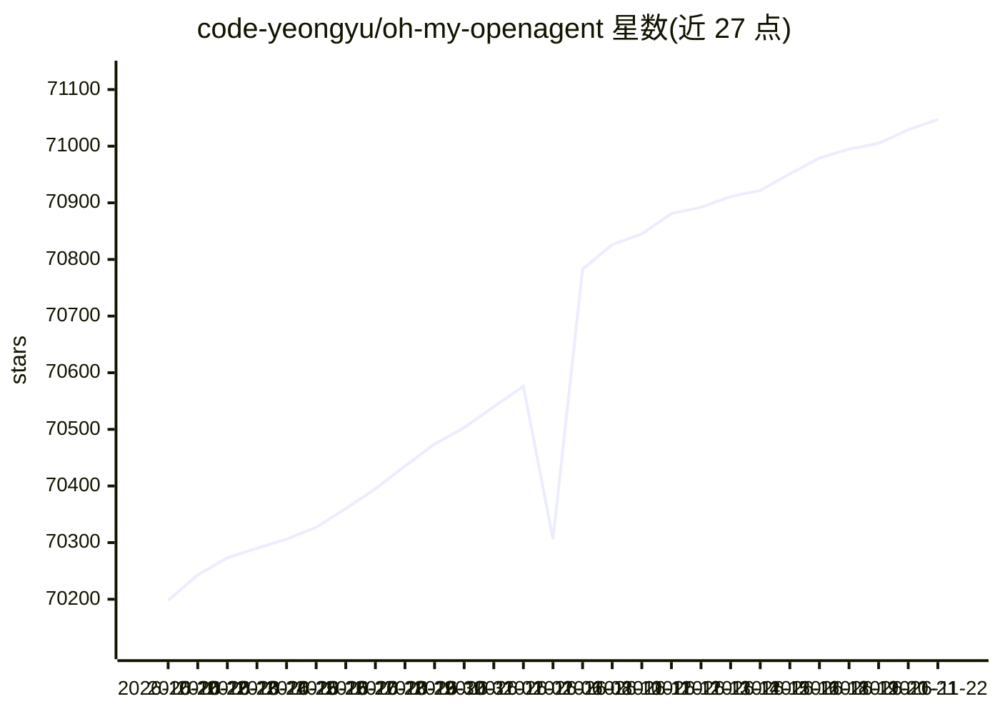

# code-yeongyu/oh-my-openagent

⭐ 71,047 · TypeScript · NOASSERTION · 推送 2026-11-21 · [GitHub](https://github.com/code-yeongyu/oh-my-openagent) · [官网](https://omo.dev) · 个人维护

**面向开发者的终端 AI agent 编排工具，多人协作图式执行任务**

OmO 提供单一 `omo` 命令，用于在终端中把任务（研究、文档、前后端代码）交给 agent 完成。输入 `mass ulw` 关键词可将任务分解为多个 agent 组成的图并行执行，各部分可运行在不同模型上并互相校验。内置基于 git 仓库 markdown 文件的记忆系统（Kibitzer）、技能按需加载、多模型混合路由，支持从 OpenCode/LazyCodex 迁移配置。提供 curl 安装脚本与 npm/bun 包两种安装方式。

## 筛选速览

| 维度 | 判定 | 备注 |
|---|---|---|
| AI 角色 | `ai-ecosystem` | LLM/agent 周边工具 |
| 许可风险 | `none` | NOASSERTION |
| 部署形态 | `library` | 以包/库形式分发 |
| 模型依赖 | locked-api |  |
| 硬件要求 | — | 无带数字的原话,不猜 |
| 安装摩擦 | `low` | 无编译、无系统依赖或容器化 |
| 成熟度 | — | 结构信号不足 |

## 动量与使用信号

- 维护:`active` — 距上次 push 0.6 天,年发版 100,330 位贡献者
- 涨星:近 1 天 **+46**(自 20261016 起算)
- 安装:npm 包 `omo-ai` 月下载 37,229
- 平台:WINDOWS · 协议:OPENAI-API / MCP

## 能力要点

- `mass ulw` 关键词把任务分解为多 agent 图并行执行
- 基于 git markdown 文件的记忆系统与轻量辅助模型
- `/login` 支持 Claude、ChatGPT、Kimi、GLM 订阅登录
- 提供 OpenCode/LazyCodex 配置迁移（omo setup/doctor）

## 适用场景

- 在终端用自然语言完成跨多文件的开发与研究任务
- 把大任务拆成多 agent 图并行跑不同模型
- 跨模型会话保留记忆，避免重复说明上下文

## 场景标签

`多智能体` `编码 Agent` · 领域:Agent 开发

## 证据(README 行号)

> L30: OmO is one `omo` command that turns your tokens into finished work: research across ten thousand sources, a deck pe
> L55: **Hundreds of agents, one keyword.** Type `mass ulw` and the whole job becomes a graph of agents: deep research ove
> L59: **Mix models without thinking about it.** Use the frontier models you love together with the cheap ones. Just sign 

## 星数曲线

2026-10-20 70,198 → 2026-11-22 71,047（+849）

---
*卡片 v1 · prompt 1.4 · 生成 2026-11-22 · 置信度 high · 依据 README sha `7a6c035681b1` · [字段定义](../../DATASET.md)*
