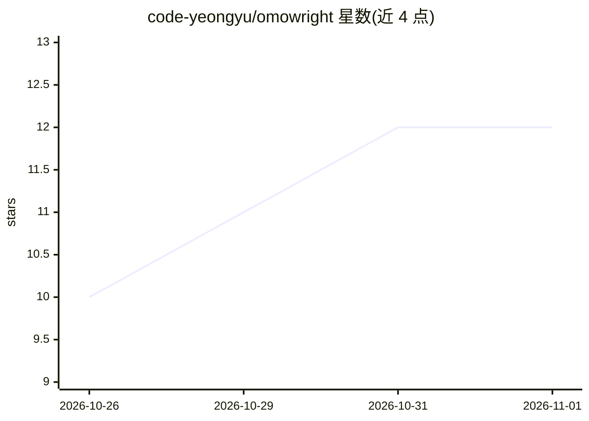

# code-yeongyu/omowright

⭐ 12 · JavaScript · MIT · 推送 2026-10-28 · [GitHub](https://github.com/code-yeongyu/omowright) · 个人维护

**给 AI agent 用的 Playwright 形态浏览器自动化库**

基于 CDP（默认经 --remote-debugging-pipe 零端口管道传输）封装的浏览器自动化库，面向构建浏览器 agent 的开发者。API 保持 Playwright 形态（page.goto、locator、mouse.wheel 等），主要读取方式为带 refs 的无障碍快照，compactSnapshot 去除重复 refs 映射，重快照以 diff 返回。将滚动收集作为核心原语：createNetworkSnoop 捕获 JSON 响应，collectWhileScrolling 驱动页面直到文档停止增长。另提供命名实例、共享连接、范围受限端点、agent 事件推送、trace 记录、CUA 坐标控制、CAPTCHA 辅助与 CloakBrowser 持久配置。附带 SKILL.md 格式的 agent 技能与任务预设。限制：自身不下载浏览器，需指向已有 Chromium/Chrome；Bun>=1.4 推荐，Node>=22 支持。

## 筛选速览

| 维度 | 判定 | 备注 |
|---|---|---|
| AI 角色 | `ai-ecosystem` | LLM/agent 周边工具 |
| 许可风险 | `permissive` | MIT |
| 部署形态 | `None` |  |
| 模型依赖 | — | README 未给出锁定关系 |
| 硬件要求 | — | 无带数字的原话,不猜 |
| 安装摩擦 | `low` | 无编译、无系统依赖或容器化 |
| 成熟度 | — | 结构信号不足 |

## 能力要点

- Playwright 形态 API，底层为 CDP 零端口管道传输
- 无障碍快照 + compactSnapshot 去重，重快照以 unified diff 返回
- createNetworkSnoop + collectWhileScrolling 滚动驱动地收集网络 JSON 数据
- 附带 SKILL.md agent 技能与 6 类任务预设

## 适用场景

- 为浏览器 agent 提供模型已熟悉形状的自动化工具层
- 抓取需滚动加载的信息流、搜索结果等列表数据
- 长时登录态任务中使用持久化 CloakBrowser 指纹配置

## 场景标签

`浏览器自动化` · 领域:效率与自动化

## 证据(README 行号)

> L5: Playwright-shaped browser automation for AI agents. The API a model already
> L161: `skills/omowright/` is a self-contained agent skill (`SKILL.md` plus

## 星数曲线

2026-10-26 10 → 2026-11-01 12（+2）

---
*卡片 v1 · prompt 1.4 · 生成 2026-11-01 · 置信度 high · 依据 README sha `d1849ad91ab4` · [字段定义](../../DATASET.md)*
