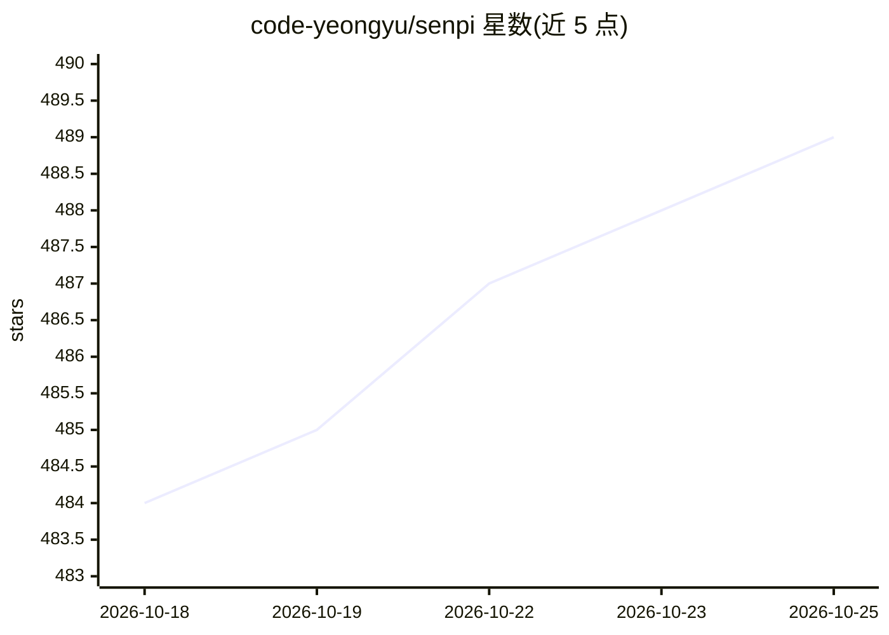

# code-yeongyu/senpi

⭐ 489 · TypeScript · MIT · 推送 2026-10-24 · [GitHub](https://github.com/code-yeongyu/senpi) · 个人维护

**pi-mono 的分叉：TypeScript 编码 agent 运行时，内置扩展集**

senpi 是 badlogic/pi-mono 的观点性分叉，将上游编码 agent 品牌化为 senpi CLI，并在上游之上叠加一组内置扩展：动态系统提示的意图门、todo 续跑循环、按模型（GPT-5.x/Claude/Kimi）的 prompt 预设、上下文压缩、权限系统（allow/deny 规则、JSONL 存储）等。设计上作为 Sisyphus Labs 的 AI 助手 Dori 的编码 agent 运行时，也可独立使用。monorepo 含统一多 provider LLM API、agent 运行时、TUI 库等包；额外能力（LSP、AST-grep）经 senpi install 安装扩展。README 自述实验性、勿用于生产流水线。

## 筛选速览

| 维度 | 判定 | 备注 |
|---|---|---|
| AI 角色 | `ai-ecosystem` | LLM/agent 周边工具 |
| 许可风险 | `permissive` | MIT |
| 部署形态 | `library` | 以包/库形式分发 |
| 模型依赖 | locked-api |  |
| 硬件要求 | — | 无带数字的原话,不猜 |
| 安装摩擦 | `low` | 无编译、无系统依赖或容器化 |
| 成熟度 | `idea` | |

## 能力要点

- pi-mono 分叉，以单一 CLI 二进制运行编码 agent，含内置扩展集
- 统一多 provider LLM API（OpenAI/Anthropic/Google 等）与工具调用 agent 运行时
- 权限系统：allow/deny 规则、JSONL 存储、TUI 交互提示
- senpi install 命令按需安装 LSP/AST-grep/评论检查等扩展

## 适用场景

- 作为独立 CLI 编码 agent 进行日常代码工作
- 为上层 AI 助手（如 Dori）提供编码 agent 运行时
- 从 OMO 迁移用户按映射表配置扩展组合

## 场景标签

`编码 Agent` `Agent 框架` · 领域:Agent 开发

## 证据(README 行号)

> L8: > ⚠️ **Experimental.** senpi is an opinionated, in-flight fork of badlogic/pi-mono. It powers Dori under the hood an
> L29: |**@earendil-works/pi-coding-agent**|Interactive coding agent CLI|

## 星数曲线

2026-10-18 484 → 2026-10-25 489（+5）

---
*卡片 v1 · prompt 1.4 · 生成 2026-10-21 · 置信度 high · 依据 README sha `7fc3c911dfe0` · [字段定义](../../DATASET.md)*
