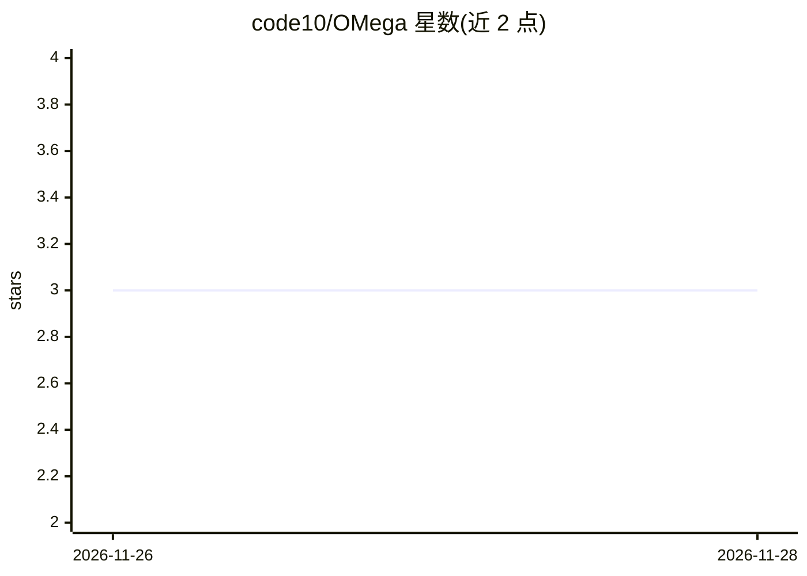

# code10/OMega

⭐ 3 · TypeScript · MIT · 推送 2026-11-27 · [GitHub](https://github.com/code10/OMega) · 个人维护

**本地优先的 Node.js agent 运行时：构建并控制自有 agent**

基于 Node.js（>=20.19.0）的轻量 agent harness，本地优先可离线运行，也可路由到云端模型。核心机制包括多模型路由与故障转移、内建离线 provider `om`（无需 API key）、human-in-the-loop 审批、隔离 git worktree、回滚快照、SHA-256 哈希链审计日志、确定性回放与评测基线对比。提供 CLI REPL、headless 运行、Web Gateway、常驻 daemon（可装为系统服务）及编程 API、JS 技能与 Markdown 工作流扩展方式。

## 筛选速览

| 维度 | 判定 | 备注 |
|---|---|---|
| AI 角色 | `ai-ecosystem` | LLM/agent 周边工具 |
| 许可风险 | `permissive` | MIT |
| 部署形态 | `library` | 以包/库形式分发 |
| 模型依赖 | local-ok | 支持本地模型 |
| 硬件要求 | — | 无带数字的原话,不猜 |
| 安装摩擦 | `low` | 无编译、无系统依赖或容器化 |
| 成熟度 | — | 结构信号不足 |

## 能力要点

- ModelRouter 支持 Gemini/OpenAI/Anthropic/DeepSeek/Ollama/vLLM 等多后端自动故障转移
- 内建 `om` 离线 provider，无需 API key 即可运行
- 哈希链审计日志与成本台账，支持 verifyChain 篡改检测
- 确定性回放（SessionTape/ReplayProvider）与 OMEvalRunner 基线评测

## 适用场景

- 在自己硬件上离线构建与运行 agent，不经第三方网关
- 为 agent 配置 cron/文件监听/webhook 自动化任务并人工审批
- 对 agent 运行记录做可审计的成本与安全追踪
- 以回放与基线对比方式回归测试 agent 行为

## 场景标签

`Agent 框架` · 领域:Agent 开发

## 证据(README 行号)

> L11: **OMega** is a lightweight, local-first agent harness you fully control | Runs offline on your hardware or routed a
> L41: - **Multi-Model Routing & Local System 1**: `ModelRouter` handles retries, rate-limit/quota cooldowns, and automati

## 星数曲线

2026-11-26 3 → 2026-11-28 3（+0）

---
*卡片 v1 · prompt 1.4 · 生成 2026-11-26 · 置信度 high · 依据 README sha `4235fa04c8ad` · [字段定义](../../DATASET.md)*
