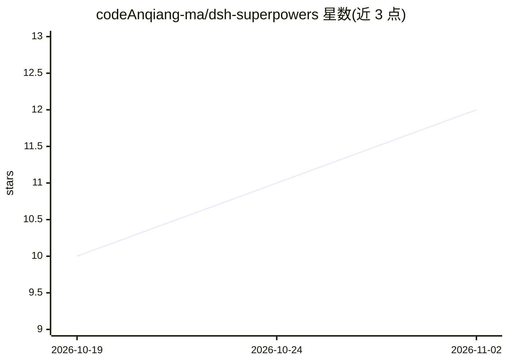

# codeAnqiang-ma/dsh-superpowers

⭐ 12 · JavaScript · NOASSERTION · 推送 2026-08-13 · [GitHub](https://github.com/codeAnqiang-ma/dsh-superpowers) · 个人维护

**为 DeepSeek Harness 移植 obra/superpowers 技能集的插件**

DeepSeek Harness（dsh）的插件：将 obra/superpowers v6.3.0 的 14 个技能（头脑风暴、规划、TDD、调试、代码审查）原样打包注册到 ctx.skills，并把 using-superpowers 引导作为系统提示段保持整个会话活跃（含上下文压缩后），固定增加约 1.1k tokens，可通过 bootstrap: false 关闭。另将 Claude Code 风格工具名映射到 dsh 等价物。零运行时依赖，需 dsh 0.1.0-rc.6+ 与 Node.js 22.19+/24+。

## 筛选速览

| 维度 | 判定 | 备注 |
|---|---|---|
| AI 角色 | `ai-ecosystem` | LLM/agent 周边工具 |
| 许可风险 | `none` | NOASSERTION |
| 部署形态 | `None` |  |
| 模型依赖 | locked-api |  |
| 硬件要求 | — | 无带数字的原话,不猜 |
| 安装摩擦 | `low` | 无编译、无系统依赖或容器化 |
| 成熟度 | — | 结构信号不足 |

## 能力要点

- 注册全部 14 个 Superpowers 技能到 ctx.skills，经原生 skill 工具加载
- bootstrap 作为系统提示段存活于上下文压缩，约 1.1k tokens 固定开销
- Claude Code 风格工具名（Task/TodoWrite/Bash 等）映射到 dsh 等价物
- 零运行时依赖，通过 ctx 访问提示与技能注册表

## 适用场景

- 在 DeepSeek Harness 中使用 Superpowers 的 TDD 与规划工作流
- 让编码 agent 先探索与设计再写代码
- 为 dsh 配置文件按需启用/关闭技能与引导段

## 场景标签

 · 领域:AI 编码工具/插件

## 证据(README 行号)

> L12: dsh-superpowers adds obra/superpowers support to DeepSeek Harness. It registers 14 skills for brainstorming, planni
> L34: - Registers all 14 Superpowers skills on `ctx.skills`. They appear in the skill catalog and load through the native
> L35: - Adds the `using-superpowers` bootstrap as the `superpowers:bootstrap` prompt section at order 50. It is present o

## 星数曲线

2026-10-19 10 → 2026-11-02 12（+2）

---
*卡片 v1 · prompt 1.4 · 生成 2026-11-02 · 置信度 high · 依据 README sha `047a8c55bfc8` · [字段定义](../../DATASET.md)*
