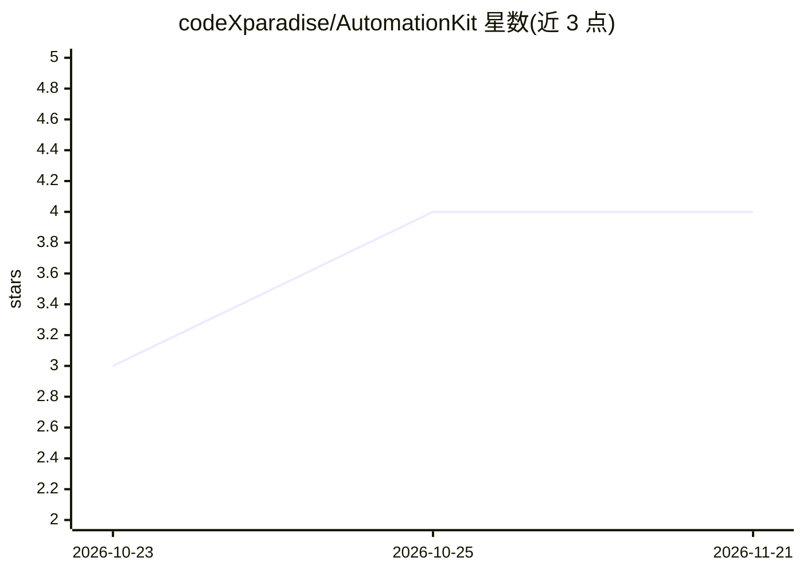

# codeXparadise/AutomationKit

⭐ 4 · HTML · MIT · 推送 2026-10-24 · [GitHub](https://github.com/codeXparadise/AutomationKit) · 个人维护

**自托管 AI 自动化栈：n8n+本地 LLM+向量搜索一键 Docker 部署**

将 11 个微服务打包为一套自托管 Docker 编排平台：n8n 工作流自动化、OpenWA WhatsApp 网关、Ollama 本地 LLM、Qdrant 向量检索、Docling 文档 OCR、Crawl4AI 爬虫、Neo4j 图数据库、Supabase、Redis、PostgreSQL，统一由 Caddy 网关代理并提供 .local 域名访问。面向想在自己机器上搭建自动化/LLM 工作流的开发者与 homelab 用户。限制：需要 Docker Desktop 与 Docker Compose v2+，Windows 本地域名映射依赖 automation.bat 脚本。

## 筛选速览

| 维度 | 判定 | 备注 |
|---|---|---|
| AI 角色 | `ai-ecosystem` | LLM/agent 周边工具 |
| 许可风险 | `permissive` | MIT |
| 部署形态 | `self-host` | docker 或自建部署 |
| 模型依赖 | local-ok | 支持本地模型 |
| 硬件要求 | — | 无带数字的原话,不猜 |
| 安装摩擦 | `low` | 无编译、无系统依赖或容器化 |
| 成熟度 | — | 结构信号不足 |

## 能力要点

- 11 个微服务统一 Docker Compose 编排，Caddy 网关自动注入 Bearer token
- OpenWA WhatsApp 免费自动化：QR 登录、多会话持久化、Redis BullMQ 异步队列
- n8n 沙箱在 Docker-in-Docker 内隔离执行生成的 Python/JS 代码
- 提供 n8n 各节点（PostgreSQL/Redis/Qdrant/Neo4j/Crawl4AI/Ollama）的连接配置蓝图

## 适用场景

- 在本地服务器搭建自托管的工作流自动化与 LLM 应用栈
- 通过 WhatsApp 消息触发 n8n 工作流并自动回复
- 组合网页爬取、OCR、向量检索构建 RAG 管道
- homelab 环境统一管理多个自托管服务

## 场景标签

`工作流自动化` `RAG` `网页抓取` `OCR` · 领域:效率与自动化

## 证据(README 行号)

> L12:  AutomationKit is a turn-key, self-hosted developer platform that packages leading workflow automation, 100% free W
> L67: |**n8n**|Workflow Automation & AI Agents|`v2.43.7`|docs.n8n.io|GitHub Repo|
> L72: |**Ollama**|Local LLMs (Llama 3, Mistral, Qwen)|`Latest`|ollama.com/library|GitHub Repo|

## 星数曲线

2026-10-23 3 → 2026-11-21 4（+1）

---
*卡片 v1 · prompt 1.4 · 生成 2026-11-21 · 置信度 mid · 依据 README sha `53cb85afcecb` · [字段定义](../../DATASET.md)*
