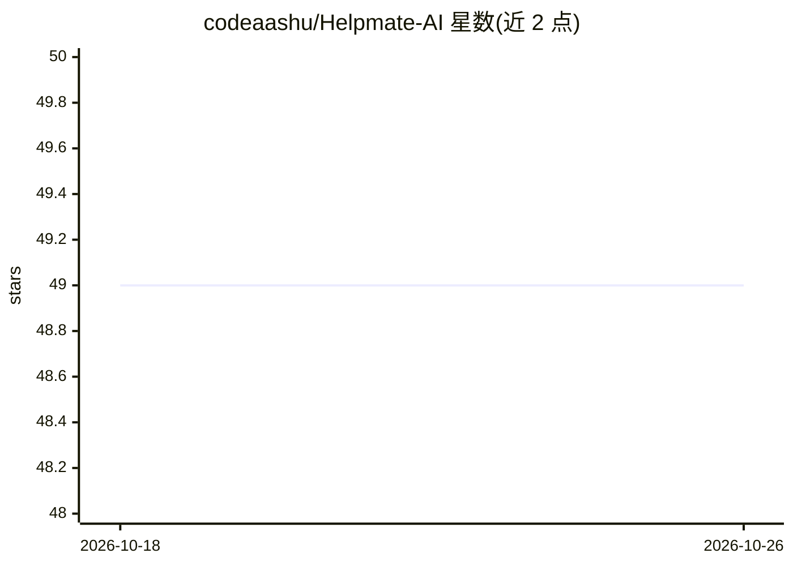

# codeaashu/Helpmate-AI

⭐ 49 · JavaScript · MIT · 推送 2026-08-29 · [GitHub](https://github.com/codeaashu/Helpmate-AI) · [官网](https://helpmate-ai.vercel.app) · 个人维护

**基于 Gemini API 的网页版 AI 聊天问答应用**

Helpmate AI 是一个 AI 聊天机器人 Web 应用：用户在文本框输入任意问题，点击 Generate Answer 后由 Google Gemini API 处理并返回文本回答。功能包括对话式 AI 界面、文本摘要与问答，前端采用 React、TailwindCSS、Vite 构建，通过 Vercel/Netlify 部署。本地运行需先获取 Google Gemini API key，再克隆仓库、npm 安装依赖并以 npm run dev 启动。项目以 MIT 许可开源，欢迎贡献者改进 UI。

## 筛选速览

| 维度 | 判定 | 备注 |
|---|---|---|
| AI 角色 | `ai-native` | 本体是模型或模型工具 |
| 许可风险 | `permissive` | MIT |
| 部署形态 | `None` |  |
| 模型依赖 | — | README 未给出锁定关系 |
| 硬件要求 | — | 无带数字的原话,不猜 |
| 安装摩擦 | `low` | 无编译、无系统依赖或容器化 |
| 成熟度 | — | 结构信号不足 |

## 能力要点

- 调用 Google Gemini API 生成问答回答
- 对话式界面，支持文本摘要与问答
- React + TailwindCSS + Vite 技术栈，响应式布局

## 适用场景

- 在网页上提问并获取 AI 生成的回答
- 作为 React + Gemini API 的示例项目学习或贡献代码

## 场景标签

`聊天机器人` · 领域:对话与助手

## 证据(README 行号)

> L12:  ` Helpmate is a AI ChatBot web app where you can ask any question and you will get the answer. `
> L39: Helpmate AI will process your question using Google Gemini API and provide you with a comprehensive answer. The ans

## 星数曲线

2026-10-18 49 → 2026-10-26 49（+0）

---
*卡片 v1 · prompt 1.4 · 生成 2026-10-24 · 置信度 high · 依据 README sha `cf357eb43654` · [字段定义](../../DATASET.md)*
