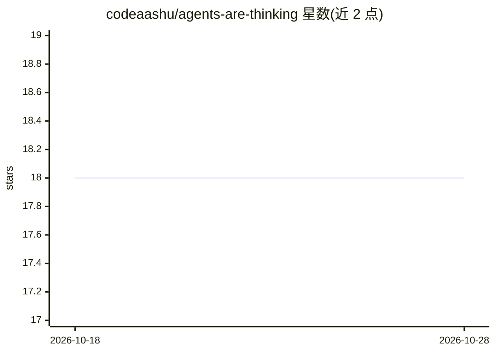

# codeaashu/agents-are-thinking

⭐ 19 · Rust · MIT · 推送 2026-08-29 · [GitHub](https://github.com/codeaashu/agents-are-thinking) · [官网](https://agents-are-thinking.aashuu.tech) · 个人维护

**终端 agent 思考状态动画库，48 种字符效果**

用 Rust 编写的终端动画效果库，为 agent 的“thinking”状态提供动画展示，含盲文、明暗块、条形、方块、圆点等 6 类共 48 种效果。无运行时依赖，通过 PyO3 提供 Python 绑定、wasm-bindgen 提供 JS/TS(WASM) 绑定，Rust/Python/JS/TS 三个生态均可安装，并提供 CLI 预览命令与在线预览页面。

## 筛选速览

| 维度 | 判定 | 备注 |
|---|---|---|
| AI 角色 | `ai-ecosystem` | LLM/agent 周边工具 |
| 许可风险 | `permissive` | MIT |
| 部署形态 | `library` | 以包/库形式分发 |
| 模型依赖 | — | README 未给出锁定关系 |
| 硬件要求 | — | 无带数字的原话,不猜 |
| 安装摩擦 | `low` | 无编译、无系统依赖或容器化 |
| 成熟度 | — | 结构信号不足 |

## 能力要点

- 48 种效果，分 braille/shade/bar/vblock/square/dot 6 类
- Rust 实现无运行时依赖，提供 Python(PyO3) 与 WASM 绑定
- 支持 Rust/Python/JS/TS 三生态安装与 CLI 预览

## 适用场景

- 为 CLI agent 的思考等待过程添加终端动画
- 在 Python 或 JS/TS 项目中嵌入思考状态指示效果
- 通过预览命令或网页快速浏览全部动画效果

## 场景标签

 · 领域:开发者工具/终端 UI

## 证据(README 行号)

> L3: Terminal animation effects for agents' "thinking" state. Braille, block characters, unicode glyphs. No runtime depen
> L7: The package is written in rust. And provides python binding using PY03, and wasm binding using wasm-bindgen.

## 星数曲线

2026-10-18 18 → 2026-10-28 18（+0）

---
*卡片 v1 · prompt 1.4 · 生成 2026-10-28 · 置信度 high · 依据 README sha `52eff69ee37d` · [字段定义](../../DATASET.md)*
