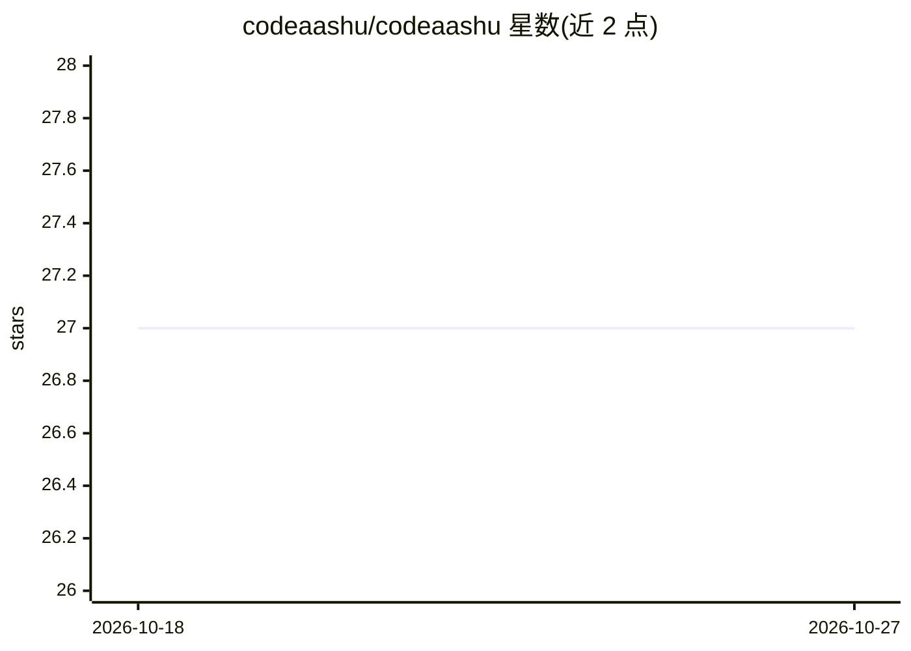

# codeaashu/codeaashu

⭐ 27 · 推送 2026-10-24 · [GitHub](https://github.com/codeaashu/codeaashu) · [官网](https://github.com/codeaashu) · 个人维护

**个人 GitHub 主页 README：展示项目与接洽方式**

这是 codeaashu（aashuu）的个人 GitHub 档案仓库，README 为个人主页介绍：自述身份为 AI 软件工程师与新兴技术研究者，列出其构建的项目（RepoXray、AVSAR、Antriview、Helpmate AI 等）、过往经历的品牌与机构，以及可承接的合同制/全职合作方向（AI SaaS、快速原型、品牌与增长策略）。仓库本身不含可安装或运行的软件，无代码、无安装说明、无依赖。

## 筛选速览

| 维度 | 判定 | 备注 |
|---|---|---|
| AI 角色 | `ai-knowledge` | 知识聚合/清单类 |
| 许可风险 | `none` | — |
| 部署形态 | `None` |  |
| 模型依赖 | — | README 未给出锁定关系 |
| 硬件要求 | — | 无带数字的原话,不猜 |
| 安装摩擦 | `low` | 无编译、无系统依赖或容器化 |
| 成熟度 | — | 结构信号不足 |

## 能力要点

- 列出 10 余个自建项目（SaaS/工具/库）
- 说明可承接的合作类型（合同制项目、原型与 MVP）
- 附个人网站与多个社交平台链接

## 适用场景

- 了解该开发者的项目与技能背景
- 通过链接接洽合作或查看作品集

## 场景标签

 · 领域:个人档案/作品集

## 证据(README 行号)

> L1: codeaashu
> L5: ### This is aashuu ✦
> L9: > AI Software Engineer ▪︎ Researcher in Emerging Technologies ▪︎ Writer

## 星数曲线

2026-10-18 27 → 2026-10-27 27（+0）

---
*卡片 v1 · prompt 1.4 · 生成 2026-10-26 · 置信度 low · 依据 README sha `c06b3960bd66` · [字段定义](../../DATASET.md)*
