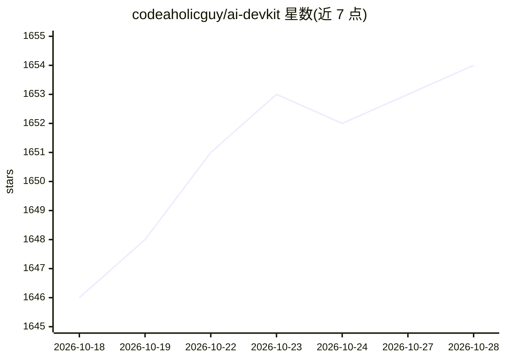

# codeaholicguy/ai-devkit

⭐ 1,653 · TypeScript · Apache-2.0 · 推送 2026-10-25 · [GitHub](https://github.com/codeaholicguy/ai-devkit) · [官网](https://ai-devkit.com) · 个人维护 · 中文 README

**AI 编程代理的本地控制平面：统一配置、控制台与记忆**

面向已使用多个 AI 编程代理（Claude Code、Codex CLI、Cursor、Gemini CLI 等）的开发者，AI DevKit 提供一层本地运行的操作层：`.ai-devkit.json` 单一配置文件对各代理生成规则、MCP 与技能；`agent console` TUI 仪表盘监视本地代理会话，`agent send` 在代理间路由提示与日志；本地 SQLite 存储项目决策与规范供按需检索（通过 MCP 与 CLI 暴露）；内置 `dev-lifecycle`、`verify`、`tdd` 等九个可组合工程技能，`skill add` 可从 30+ 发布者拉取。Apache-2.0，本地运行无遥测。自声明不替代这些代理工具，仅配置、监督与协调。

## 筛选速览

| 维度 | 判定 | 备注 |
|---|---|---|
| AI 角色 | `ai-ecosystem` | LLM/agent 周边工具 |
| 许可风险 | `permissive` | Apache-2.0 |
| 部署形态 | `library` | 以包/库形式分发 |
| 模型依赖 | locked-api |  |
| 硬件要求 | — | 无带数字的原话,不猜 |
| 安装摩擦 | `low` | 无编译、无系统依赖或容器化 |
| 成熟度 | — | 结构信号不足 |

## 能力要点

- 单一配置 `.ai-devkit.json` 对 15 种编程代理生成规则/MCP/技能
- `agent console` TUI 监视运行中的多代理会话，`agent send` 跨代理路由消息
- 本地 SQLite 记忆经 MCP/CLI 按需检索，避免上下文膨胀
- 九个内置工程技能（dev-lifecycle/verify/tdd 等），可从 30+ 发布者追加技能

## 适用场景

- 团队统一维护多个 AI 编程代理的配置与规则
- 从单一控制台监视并远程操控多个运行中的代理会话
- 让代理跨会话检索项目决策与编码规范
- 用 dev-lifecycle 等技能约束代理按需求-设计-实现-测试流程工作

## 场景标签

`Agent 框架` `Agent 记忆` · 领域:Agent 开发

## 证据(README 行号)

> L7: AI DevKit gives Claude Code, Codex CLI, Gemini CLI, opencode, Pi, Cursor, GitHub Copilot, Devin, and other coding ag
> L10: - **One console for running sessions** — `agent console` is a live TUI dashboard for supervising local agents acros
> L24: |Retrieval-based memory|Local SQLite memory exposed through MCP and CLI, searched only when useful|

## 星数曲线

2026-10-18 1,646 → 2026-10-28 1,654（+8）

---
*卡片 v1 · prompt 1.4 · 生成 2026-10-21 · 置信度 high · 依据 README sha `5a99d2914a80` · [字段定义](../../DATASET.md)*
