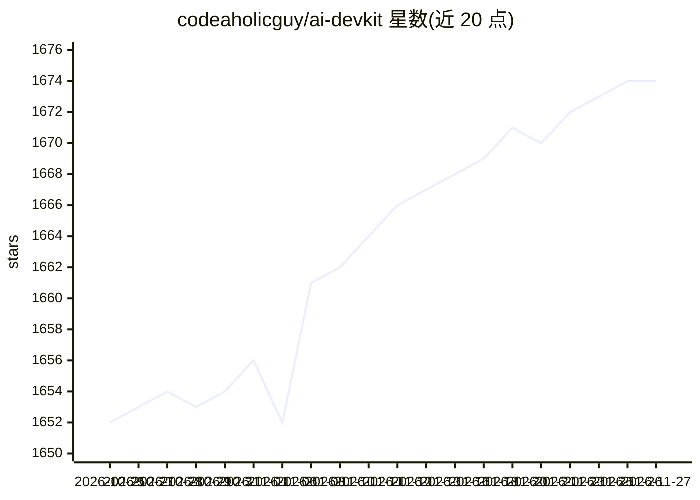

# codeaholicguy/ai-devkit

⭐ 1,674 · TypeScript · Apache-2.0 · 推送 2026-11-26 · [GitHub](https://github.com/codeaholicguy/ai-devkit) · [官网](https://ai-devkit.com) · 个人维护

**为 AI 编码 agent 提供统一配置、控制台与记忆的管理层**

以 npm CLI 形式提供的 AI 编码 agent 管理工具：`setup` 一次性完成机器级安装，`init` 在项目内生成 `.ai-devkit.json` 统一配置并写入各 agent 的规则、MCP 与技能。控制面提供 `agent list/detail/console` 查看会话、`agent send` 向运行中的 agent 发送提示与日志（基于 tmux，仅 macOS/Linux，Windows 控制台不支持）；`@ai-devkit/memory` 将项目决策与约定存入本地 SQLite，通过 MCP/CLI 按需检索；内置 28 个技能，`dev-lifecycle` 为主线串联 verify、tdd、调试、评审等流程，`skill add` 可从 30+ 发布者拉取技能。Apache-2.0，本地运行，无遥测。

## 筛选速览

| 维度 | 判定 | 备注 |
|---|---|---|
| AI 角色 | `ai-ecosystem` | LLM/agent 周边工具 |
| 许可风险 | `permissive` | Apache-2.0 |
| 部署形态 | `library` | 以包/库形式分发 |
| 模型依赖 | — | README 未给出锁定关系 |
| 硬件要求 | — | 无带数字的原话,不猜 |
| 安装摩擦 | `low` | 无编译、无系统依赖或容器化 |
| 成熟度 | — | 结构信号不足 |

## 能力要点

- `.ai-devkit.json` 一份配置协调多个编码 agent 的规则、技能与 MCP 设置
- `agent list/send/console` 跨提供方列出、检视、消息化运行中的 agent 会话
- 本地 SQLite 记忆按需检索，避免每次 prompt 携带全部上下文
- 28 个内置技能，`dev-lifecycle` 串联需求→设计→实现→测试→评审

## 适用场景

- 团队同时使用多个 AI 编码 agent 时统一配置与管理入口
- 向长时间运行的 agent 发送日志、测试输出等上下文
- 跨会话保存并检索项目约定，避免 agent 遗忘规范
- 用 dev-lifecycle 技能约束 agent 按阶段完成功能开发

## 场景标签

`Agent 框架` `Agent 记忆` · 领域:Agent 开发

## 证据(README 行号)

> L7: AI DevKit gives Claude Code, Codex CLI, Gemini CLI, opencode, Pi, Cursor, GitHub Copilot, Devin, and other coding ag
> L9: - **One config for every agent** — `.ai-devkit.json` reconciles setup across the coding tools your team uses
> L12: - **Memory retrieval without context bloat** — `@ai-devkit/memory` stores decisions, conventions, and fixes in loca

## 星数曲线

2026-10-25 1,652 → 2026-11-27 1,674（+22）

---
*卡片 v1 · prompt 1.4 · 生成 2026-11-26 · 置信度 high · 依据 README sha `8baa68717573` · [字段定义](../../DATASET.md)*
