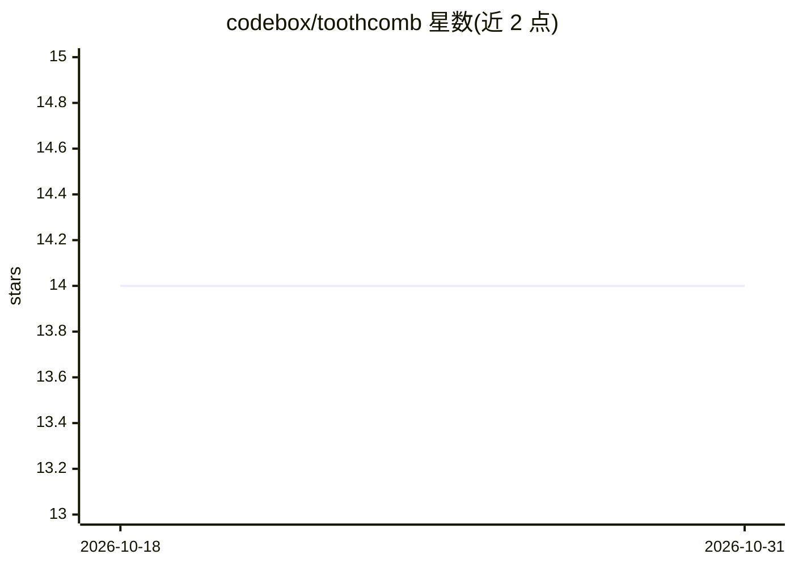

# codebox/toothcomb

⭐ 14 · Python · GPL-3.0 · 推送 2026-10-13 · [GitHub](https://github.com/codebox/toothcomb) · [官网](https://codebox.net/toothcomb) · 个人维护

**实时语音分析与事实核查工具：转录演讲并逐条核查声明**

面向终端用户的事实核查应用：输入演讲文本、MP3 或麦克风实时音频，本地用 NVIDIA Parakeet（可选 Whisper）转录后，将文本切分为 utterance 分批发送给 Anthropic Claude 模型，识别声明、承诺、逻辑谬误与操纵性语言，需要时联网检索核查，最后对全文做整体复核（如自相矛盾检测）。分析文本与结果发送至 Anthropic，其余数据存本地 SQLite。需 Python 3.12 与 Node.js v22（Docker 内自动装），或 Claude Pro/Max 订阅经 Claude Code 调用。提供在线 demo。

## 筛选速览

| 维度 | 判定 | 备注 |
|---|---|---|
| AI 角色 | `ai-native` | 本体是模型或模型工具 |
| 许可风险 | `viral` | GPL-3.0 |
| 部署形态 | `self-host` | docker 或自建部署 |
| 模型依赖 | locked-api |  |
| 硬件要求 | `cpu-ok` | |
| 安装摩擦 | `low` | 无编译、无系统依赖或容器化 |
| 成熟度 | — | 结构信号不足 |

## 能力要点

- 三阶段分析：utterance 切分→AI 审查→全文最终复核（矛盾检测）
- 本地 Parakeet 转录，支持 NVIDIA GPU 与 Apple Silicon GPU
- 支持 Claude Pro/Max 订阅经 Claude Code 替代 API key 计费
- macOS/Linux 原生运行（make run）及 Docker CPU/GPU 两种 profile

## 适用场景

- 核查政客演讲中的声明与承诺真伪
- 实时分析麦克风或 MP3 音频中的言论
- 识别演讲中的逻辑谬误与操纵性话术

## 场景标签

 · 领域:媒体/信息核查

## 证据(README 行号)

> L1: Toothcomb is an AI-powered tool for analysing and fact-checking speech in real time.
> L7: Give Toothcomb a speech transcript and it will fact-check and analyse it. If you have an MP3 file of someone speakin
> L11: 1. The text is broken up into small parts referred to as 'utterances'. Each utterance is usually a few sentences in

## 星数曲线

2026-10-18 14 → 2026-10-31 14（+0）

---
*卡片 v1 · prompt 1.4 · 生成 2026-10-31 · 置信度 high · 依据 README sha `9f2036d1f445` · [字段定义](../../DATASET.md)*
