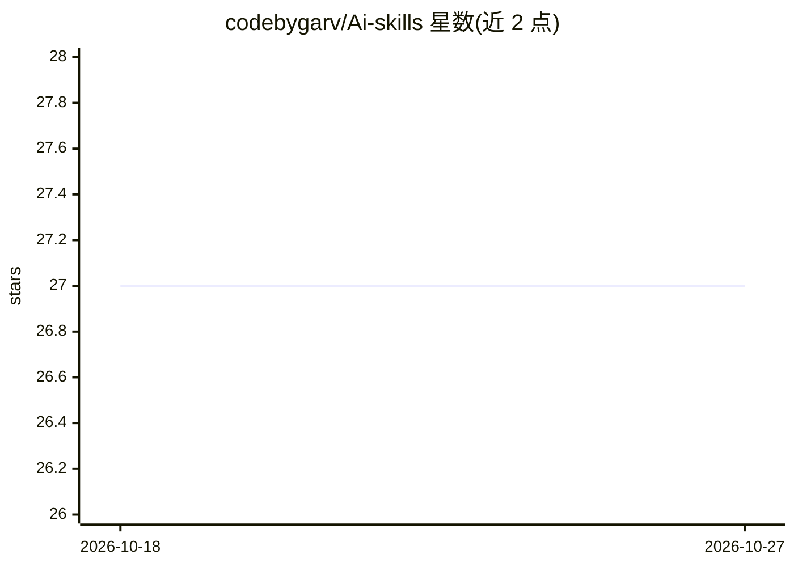

# codebygarv/Ai-skills

⭐ 27 · JavaScript · MIT · 推送 2026-08-20 · [GitHub](https://github.com/codebygarv/Ai-skills) · 个人维护

**社区维护的 120+ 条可复用 AI agent 技能目录，npx 一键安装**

社区驱动的 AI 技能集中目录：收录 120 个技能，按 Reasoning、Development、UI/UX 等 9 个类别组织。每个技能是一个自包含的 Markdown+YAML frontmatter 指令包，定义 AI 该做什么、何时使用、遵循的规则与输出。技能默认安装到 .claude/skills/，也可通过 --target 参数安装到 Google Antigravity、Cursor、Windsurf、GitHub Copilot、Roo Code/Cline、Aider 等其他 agent 的目录。安装方式为单条 npx github:codebygarv/Ai-skills add 命令，接受 PR 贡献。

## 筛选速览

| 维度 | 判定 | 备注 |
|---|---|---|
| AI 角色 | `ai-knowledge` | 知识聚合/清单类 |
| 许可风险 | `permissive` | MIT |
| 部署形态 | `self-host` | docker 或自建部署 |
| 模型依赖 | — | README 未给出锁定关系 |
| 硬件要求 | — | 无带数字的原话,不猜 |
| 安装摩擦 | `low` | 无编译、无系统依赖或容器化 |
| 成熟度 | — | 结构信号不足 |

## 能力要点

- 120 个技能按 9 个类别组织
- 标准 Skill Specification 格式，兼容多家 AI 编码助手
- npx 单命令安装，可指定安装目标目录
- 技能覆盖推理、代码审查、安全审计、SQL 优化、可访问性检查等

## 适用场景

- 为 AI 编码助手查找现成的代码审查或安全审计技能
- 避免重复编写相同的提示词与 agent 行为指令
- 在不同 AI 助手（Claude Code/Cursor/Windsurf 等）间复用技能

## 场景标签

`提示工程` `精选清单` · 领域:Agent 开发

## 证据(README 行号)

> L50: AI Skills Hub is a centralized catalogue of reusable AI skills designed to extend the capabilities of AI coding age
> L90: 120 skills across 9 categories.

## 星数曲线

2026-10-18 27 → 2026-10-27 27（+0）

---
*卡片 v1 · prompt 1.4 · 生成 2026-10-26 · 置信度 mid · 依据 README sha `63acd3ba80e5` · [字段定义](../../DATASET.md)*
