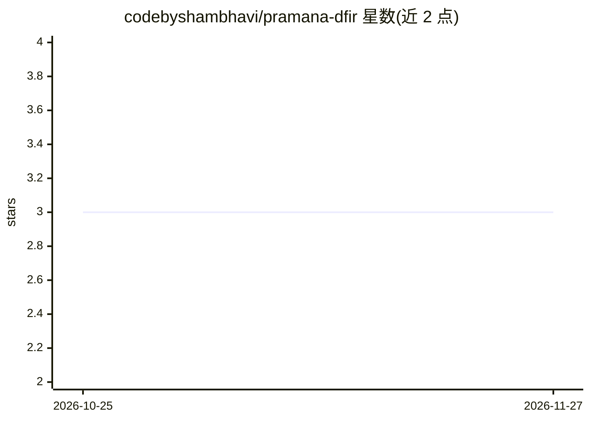

# codebyshambhavi/pramana-dfir

⭐ 3 · Python · 推送 2026-11-24 · [GitHub](https://github.com/codebyshambhavi/pramana-dfir) · [官网](https://pramana-dfir.vercel.app) · 个人维护

**面向网络取证调查者的证据溯源分析平台**

本地优先的数字取证调查平台：入库时对证据做 SHA-256 哈希校验并记录哈希链保管日志，将浏览器、聊天、日志、PCAP、图像等来源归一化为带 schema 校验的事件，按共享 actor/设备/IP/哈希在时间窗口内做跨源关联，检测矛盾与异常并生成必须引用至少一个事件的发现，每条发现可回溯至原始文件；调查员对发现逐条批准或驳回，最终导出 PDF 报告。本地 LLM 仅基于给定事件撰写叙述，无引用的句子会被拒绝。

## 筛选速览

| 维度 | 判定 | 备注 |
|---|---|---|
| AI 角色 | `ai-enhanced` | 去掉 AI 部分产品仍成立 |
| 许可风险 | `none` | — |
| 部署形态 | `self-host` | docker 或自建部署 |
| 模型依赖 | local-ok | 支持本地模型 |
| 硬件要求 | — | 无带数字的原话,不猜 |
| 安装摩擦 | `low` | 无编译、无系统依赖或容器化 |
| 成熟度 | — | 结构信号不足 |

## 能力要点

- 发现→事件→证据→SHA-256 的完整证据链与篡改检测的保管日志
- 跨源关联、矛盾检测与基于规则的异常检测
- 本地 LLM（Ollama）生成仅可引用给定事件的叙述
- 提供 Event/Finding JSON Schema 与 OpenAPI 合同

## 适用场景

- 将多来源数字证据整合为可辩护的调查时间线
- 为每条调查结论保留可回溯的证据链条
- 按 BSA Section 63 格式整理证据表格出具报告

## 场景标签

`网络安全` · 领域:学习与行业

## 证据(README 行号)

> L7: PRAMANA is a local-first, AI-assisted platform for cyber investigation and digital forensics.
> L88: **Forensics first, AI second.** Hashing, extraction, correlation and anomaly rules are deterministic code that anyo

## 星数曲线

2026-10-25 3 → 2026-11-27 3（+0）

---
*卡片 v1 · prompt 1.4 · 生成 2026-11-22 · 置信度 mid · 依据 README sha `98eef75fa317` · [字段定义](../../DATASET.md)*
