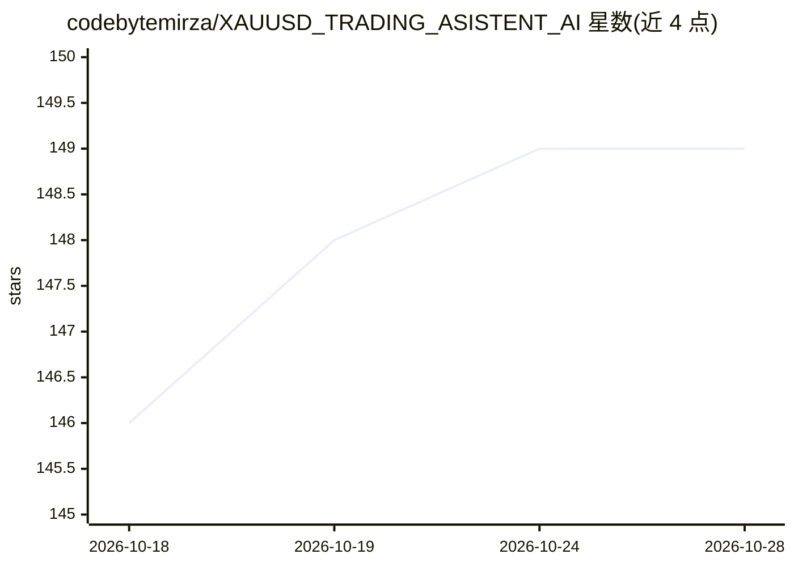

# codebytemirza/XAUUSD_TRADING_ASISTENT_AI

⭐ 150 · Python · 推送 2026-01-19 · [GitHub](https://github.com/codebytemirza/XAUUSD_TRADING_ASISTENT_AI) · [官网](https://www.linkedin.com/in/muhammad-abdullah-ai-ml-developer/) · 个人维护

**黄金 XAUUSD 交易辅助：LLM 生成交易信号的 Streamlit 面板**

面向外汇黄金交易者的交易辅助工具：通过 MetaTrader 5 获取实时行情，在 D1/M15 等多时间框架上计算 RSI、EMA、ATR 等指标，并识别订单块、Fair Value Gap、供需区，调用 Groq LLM 生成交易建议；配套 Streamlit 交互面板展示分析、信号、点差与自动刷新。需 Python 3.8+、MetaTrader 5 账户与 Groq API key，声明单笔风险 1% 且用 ATR 动态止损；README 注明仅用于教育目的，另指向更新版本仓库。

## 筛选速览

| 维度 | 判定 | 备注 |
|---|---|---|
| AI 角色 | `ai-native` | 本体是模型或模型工具 |
| 许可风险 | `none` | — |
| 部署形态 | `library` | 以包/库形式分发 |
| 模型依赖 | locked-api |  |
| 硬件要求 | — | 无带数字的原话,不猜 |
| 安装摩擦 | `low` | 无编译、无系统依赖或容器化 |
| 成熟度 | — | 结构信号不足 |

## 能力要点

- 多时间框技术分析（D1/H4/H1/M30/M15/M5）
- 基于 Groq LLM 的交易信号生成
- 订单块、FVG、供需区识别与 ATR 动态止损
- Streamlit 交互面板含自动刷新

## 适用场景

- 查看黄金多时间框技术分析与 AI 交易建议
- 通过面板监控行情与点差变化
- 在 MetaTrader 5 账户基础上获取信号辅助决策

## 场景标签

`金融量化` · 领域:学习与行业

## 证据(README 行号)

> L9: - AI-powered trade signal generation using Groq LLM
> L10: - Real-time market data analysis via MetaTrader 5
> L58: - Get AI-generated trading signals

## 星数曲线

2026-10-18 146 → 2026-10-28 149（+3）

---
*卡片 v1 · prompt 1.4 · 生成 2026-10-22 · 置信度 high · 依据 README sha `d8f10615799b` · [字段定义](../../DATASET.md)*
