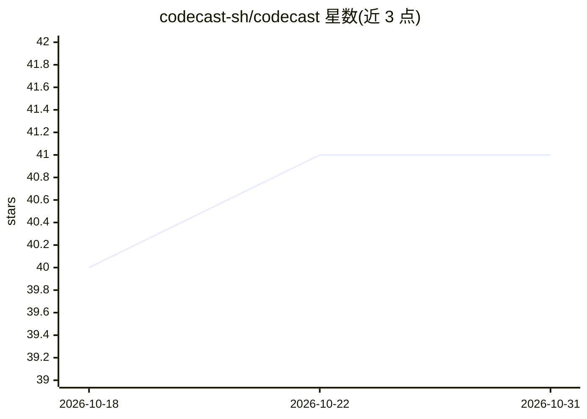

# codecast-sh/codecast

⭐ 41 · TypeScript · MIT · 推送 2026-10-30 · [GitHub](https://github.com/codecast-sh/codecast) · [官网](https://codecast.sh) · 组织维护

**把人与编码 agent 聚在一个工作区的协作平台**

面向运行多个编码 agent 的团队：后台守护进程读取本地或云主机上 Claude Code、Codex、Cursor、Gemini、OpenCode、pi、Grok 等 agent 写入的历史文件并实时同步会话，无需重新配置。工作区提供按下一步行动者排序的收件箱、决策队列、任务/计划/文档、PR 关联会话、跨会话搜索与 cast blame 溯源、聊天与带说话人转写的通话、自动化工作流及发布页面。安装脚本附带预编译二进制，无需运行时；支持 macOS/Linux/Windows。

## 筛选速览

| 维度 | 判定 | 备注 |
|---|---|---|
| AI 角色 | `ai-ecosystem` | LLM/agent 周边工具 |
| 许可风险 | `permissive` | MIT |
| 部署形态 | `library` | 以包/库形式分发 |
| 模型依赖 | — | README 未给出锁定关系 |
| 硬件要求 | — | 无带数字的原话,不猜 |
| 安装摩擦 | `low` | 无编译、无系统依赖或容器化 |
| 成熟度 | `idea` | |

## 能力要点

- 守护进程监听多种 agent 的历史文件，实时同步会话
- cast blame 将每行代码归属到写它的会话
- 决策队列集中处理需要人来做的选择
- 跨会话搜索与 cast ask 带行级引用的问答

## 适用场景

- 一个人同时监督几十个编码 agent 的进展
- 把任意代码行追溯到产生它的 agent 会话
- 用任务、计划和审批门编排多 agent 自动化工作流

## 场景标签

`多智能体` `工作流自动化` · 领域:Agent 开发

## 证据(README 行号)

> L19: It works with the agents you already run. A background daemon watches the history files they write, on your laptop 
> L21: One person can run dozens of agents and still be in command of them. An inbox sorts every session by who acts next.
> L64: - **Every agent.** Claude Code, Codex, Cursor, Gemini, OpenCode, pi, Grok and Muse Spark, plus cloud agents from Cu

## 星数曲线

2026-10-18 40 → 2026-10-31 41（+1）

---
*卡片 v1 · prompt 1.4 · 生成 2026-10-25 · 置信度 mid · 依据 README sha `9329b5894041` · [字段定义](../../DATASET.md)*
