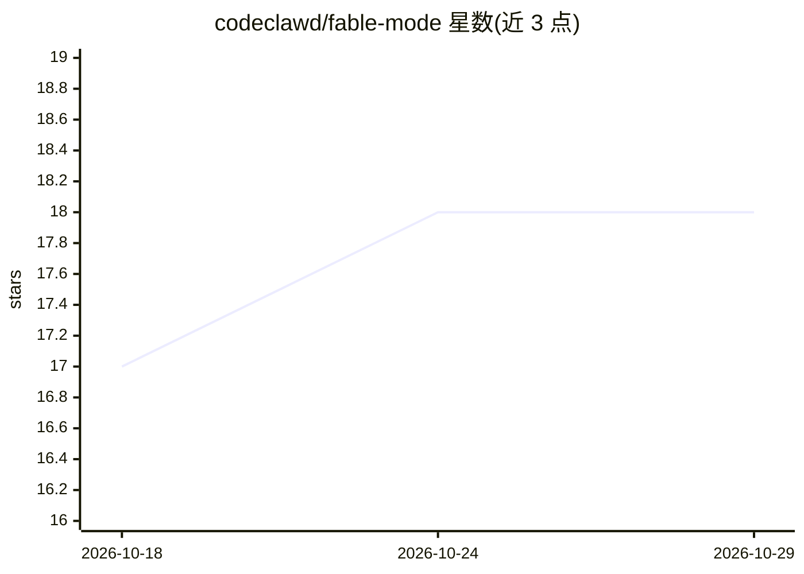

# codeclawd/fable-mode

⭐ 18 · Python · NOASSERTION · 推送 2026-09-10 · [GitHub](https://github.com/codeclawd/fable-mode) · 个人维护

**在 Claude Code 上复现 Fable 操作风格的提示层与钩子包**

面向 Claude Code 用户的配置包：将 Fable 5 的 Claude Code 操作层原创蒸馏为 FABLE_CODE.md，配合测量得出的执行手册、会话启动/提示钩子注入规则、test-after-edit 测试钩子及多个技能，使 Opus 4.8 / Sonnet 5 / Fable 5.1 会话按 Fable 的纪律运行，以降低对 Fable 5.1 用量配额的消耗。安装为 git clone 后运行 Python 脚本，需本机已有 Python ≥3.9 与 Claude Code，无需 API key。README 声明其能力上限：在非 Fable 模型上仅传递行为倾向而非原始能力。

## 筛选速览

| 维度 | 判定 | 备注 |
|---|---|---|
| AI 角色 | `ai-ecosystem` | LLM/agent 周边工具 |
| 许可风险 | `none` | NOASSERTION |
| 部署形态 | `library` | 以包/库形式分发 |
| 模型依赖 | — | README 未给出锁定关系 |
| 硬件要求 | — | 无带数字的原话,不猜 |
| 安装摩擦 | `low` | 无编译、无系统依赖或容器化 |
| 成熟度 | — | 结构信号不足 |

## 能力要点

- FABLE_CODE.md 原创蒸馏 Fable 的 Claude Code 操作层
- 双事件钩子按会话注入规则并支持自动激活启发式
- test-after-edit 钩子在每次编辑后运行项目测试
- fable launcher 通过 FABLE_MODEL 变量选择运行模型

## 适用场景

- 日常编码会话用 Opus/Sonnet 获得 Fable 风格输出以节省用量配额
- 在 Claude Code 中强制执行编辑后测试与证据先行纪律
- 按需切换模型运行同一套操作层

## 场景标签

`提示工程` · 领域:Agent 开发

## 证据(README 行号)

> L4: Fable 5.1's Claude Code operating layer, distilled and hook-enforced, so Opus 4.8 or Sonnet 5 work the way Fable wor
> L62: The installer copies everything into `~/.claude`, adds the `fable` launcher (to your shell rc on Unix, to your Powe
> L77: - **Hooks** — `fable-trigger.py` is a dual-event hook (SessionStart + UserPromptSubmit) that injects `FABLE_CODE.md

## 星数曲线

2026-10-18 17 → 2026-10-29 18（+1）

---
*卡片 v1 · prompt 1.4 · 生成 2026-10-29 · 置信度 mid · 依据 README sha `c2e49ed5466a` · [字段定义](../../DATASET.md)*
