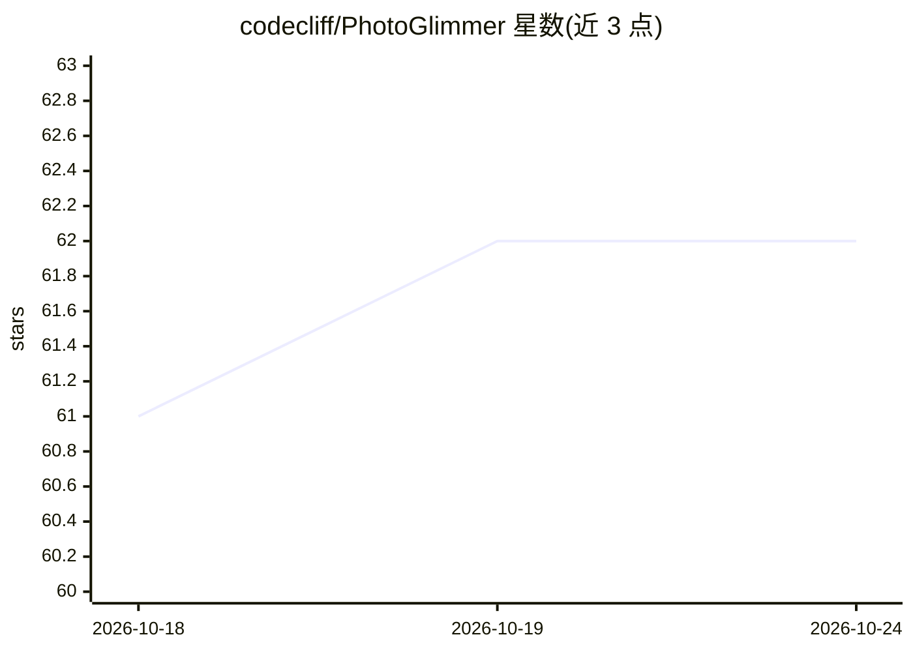

# codecliff/PhotoGlimmer

⭐ 62 · Python · LGPL-2.1 · 推送 2026-10-02 · [GitHub](https://github.com/codecliff/PhotoGlimmer) · [官网](https://github.com/codecliff/PhotoGlimmer) · 个人维护

**面向 Linux 桌面的本地 AI 人像补光图像编辑器**

基于 PySide6 的桌面图像编辑应用，嵌入 OpenCV 与 Google MediaPipe，在本地离线运行：用户在图像上框选人物，AI 分割出人物与背景，随后可分别调整人物/面部/背景的亮度、色调、白平衡、背景虚化等，支持逐人编辑、手动修改 AI 选区、实时预览与撤销重做。主打摄影爱好者的欠光人像修复场景，不需要 GPU，可处理最高约 50 兆像素图像。提供 AppImage、Snap、Flatpak、deb、MSI 等安装包，也可从源码运行，采用 LGPL-2.1 许可。

## 筛选速览

| 维度 | 判定 | 备注 |
|---|---|---|
| AI 角色 | `ai-native` | 本体是模型或模型工具 |
| 许可风险 | `viral` | LGPL-2.1 |
| 部署形态 | `desktop` | 安装包/桌面程序 |
| 模型依赖 | — | README 未给出锁定关系 |
| 硬件要求 | — | 无带数字的原话,不猜 |
| 安装摩擦 | `low` | 无编译、无系统依赖或容器化 |
| 成熟度 | — | 结构信号不足 |

## 能力要点

- AI 分离人物与背景，无需手动抠图，可分别调整亮度
- 完全本地离线运行，无需 GPU，不发送数据到服务器
- 支持逐人/分组编辑、中间调/阴影/高光分别调整、面部补光、眼部增强
- 提供 AppImage/Snap/Flatpak/deb/MSI 安装包，依赖自包含

## 适用场景

- 修复背景明亮但人物欠光的旅行/家庭照片
- 对人像提亮同时压暗或虚化背景
- 在 Linux 上离线处理大尺寸照片且保留 Exif 数据

## 场景标签

`图像视频处理` · 领域:感知与多模态

## 证据(README 行号)

> L61: PhotoGlimmer is an image editing application that leverages Artificial Intelligence tools to separate people in the
> L65: PhotoGlimmer embeds OpenCV and Google's MediaPipe and works totally offline.

## 星数曲线

2026-10-18 61 → 2026-10-24 62（+1）

---
*卡片 v1 · prompt 1.4 · 生成 2026-10-24 · 置信度 high · 依据 README sha `8cecc3292c5a` · [字段定义](../../DATASET.md)*
