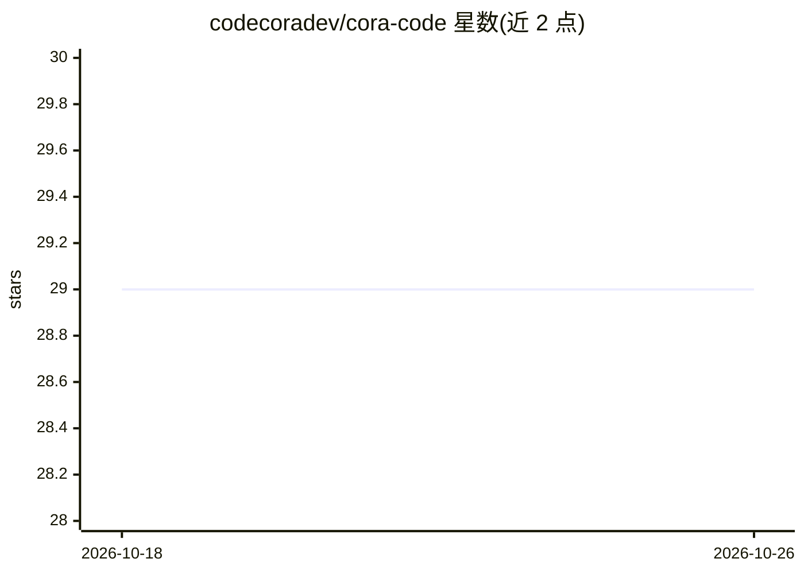

# codecoradev/cora-code

⭐ 29 · Rust · Apache-2.0 · 推送 2026-10-22 · [GitHub](https://github.com/codecoradev/cora-code) · [官网](https://codecora.dev) · 组织维护

**给开发者的 BYOK AI 代码审查 CLI，本地索引与语义搜索**

Rust 编写的命令行 AI 代码审查与代码智能工具，可在终端、CI/CD、git hook 或 AI 编码 agent 中运行。支持 OpenAI、Anthropic、Groq、Ollama、Z.AI 等 provider，自带密钥；同时内置不依赖 LLM 的确定性扫描（12 条规则、13 类安全模式、15 类密钥检测），无 key 也可运行。提供符号索引、调用图追踪、影响分析、混合语义搜索（FTS5+向量+图，RRF 融合）以及 22 个工具的 MCP server。安装方式为安装脚本下载预编译二进制或 cargo 源码构建；macOS 预编译二进制未公证，需手动移除 quarantine 属性或改用 cargo/Homebrew。

## 筛选速览

| 维度 | 判定 | 备注 |
|---|---|---|
| AI 角色 | `ai-native` | 本体是模型或模型工具 |
| 许可风险 | `permissive` | Apache-2.0 |
| 部署形态 | `library` | 以包/库形式分发 |
| 模型依赖 | local-ok | 支持本地模型 |
| 硬件要求 | — | 无带数字的原话,不猜 |
| 安装摩擦 | `low` | 无编译、无系统依赖或容器化 |
| 成熟度 | — | 结构信号不足 |

## 能力要点

- 多 provider 接入（OpenAI/Anthropic/Groq/Ollama/Z.AI 及 OpenAI 兼容 API），BYOK
- 确定性扫描（12 规则+13 安全模式+15 密钥检测）无需 LLM 即可运行
- 代码智能：符号索引（15 语言）、调用图、影响分析、混合语义搜索
- MCP server 提供 22 个工具供 AI 编码 agent 调用

## 适用场景

- 在 pre-commit 阶段自动审查代码变更
- 在 CI/CD 流水线中执行 AI 代码审查并输出 SARIF
- 跨仓库做符号检索、调用链追踪与影响分析
- 让 AI 编码 agent 通过 MCP 调用审查与检索能力

## 场景标签

`代码审查` `语义搜索` · 领域:编码与开发

## 证据(README 行号)

> L11: **Cora** is a fast, native CLI for AI-powered code review and code intelligence — in your terminal, CI/CD, git hook
> L15: - 🤖 **Multi-LLM** — OpenAI, Anthropic, Groq, Ollama, Z.AI, or any OpenAI-compatible API

## 星数曲线

2026-10-18 29 → 2026-10-26 29（+0）

---
*卡片 v1 · prompt 1.4 · 生成 2026-10-26 · 置信度 high · 依据 README sha `85553ac572ec` · [字段定义](../../DATASET.md)*
