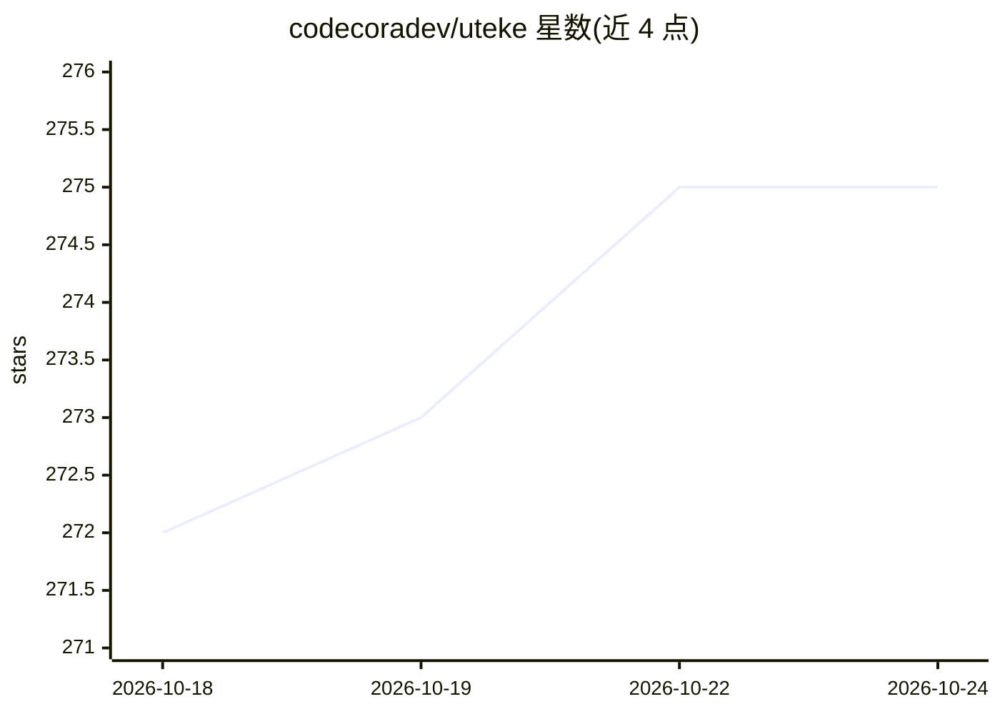

# codecoradev/uteke

⭐ 275 · Rust · Apache-2.0 · 推送 2026-10-22 · [GitHub](https://github.com/codecoradev/uteke) · [官网](https://codecora.dev) · 组织维护

**面向 AI agent 的本地优先记忆引擎，单 Rust 二进制，离线语义检索**

为 AI agent 提供持久记忆的本地引擎：存储、召回与检索记忆，采用本地 ONNX 嵌入（EmbeddingGemma Q4, 768d）+ HNSW 向量索引 + SQLite FTS5 全文检索，经 RRF 融合排序。检索路径零 LLM 调用、无 API key、CPU-only、完全离线。通过 MCP server（stdio 与 HTTP）接入 Claude Code、Cursor 等 agent，另有 Rooms 多 agent 共享记忆、时间旅行查询、关系图、智能衰减等特性。Rust 1.85+ 编译，提供安装脚本、Homebrew、Cargo、Docker 与各平台二进制，首次运行需下载约 200MB 嵌入模型。

## 筛选速览

| 维度 | 判定 | 备注 |
|---|---|---|
| AI 角色 | `ai-ecosystem` | LLM/agent 周边工具 |
| 许可风险 | `permissive` | Apache-2.0 |
| 部署形态 | `self-host` | docker 或自建部署 |
| 模型依赖 | — | README 未给出锁定关系 |
| 硬件要求 | `cpu-ok` | |
| 安装摩擦 | `low` | 无编译、无系统依赖或容器化 |
| 成熟度 | — | 结构信号不足 |

## 能力要点

- HNSW 向量 + FTS5 全文 + RRF 融合的混合检索，默认零 LLM 调用
- MCP server（stdio + Streamable HTTP）接入 Claude Code / Cursor / Hermes 等 agent
- Rooms 多 agent 共享记忆、时间旅行查询、关系图与智能衰减
- LongMemEval-S recall_any@5 报告 98.2%，基准复现工具链内置仓库

## 适用场景

- 为 AI agent 增加跨会话持久记忆且数据不出本机
- 医疗、金融、法律等隐私敏感场景的离线记忆存储
- 团队通过 Rooms 共享会议记录与项目决策并支持检索

## 场景标签

`Agent 记忆` `多智能体` `语义搜索` · 领域:Agent 开发

## 证据(README 行号)

> L8:  Give your AI a memory that never leaves your machine. Works with Claude, Cursor, Copilot, and any MCP-compatible ag
> L38: { "mcpServers": { "uteke": { "command": "uteke-mcp" } } }
> L175: |🔌 **MCP Server**|JSON-RPC over stdio + Streamable HTTP. Works with Claude Code, Cursor, Hermes.|

## 星数曲线

2026-10-18 272 → 2026-10-24 275（+3）

---
*卡片 v1 · prompt 1.4 · 生成 2026-10-22 · 置信度 mid · 依据 README sha `35b907400a7a` · [字段定义](../../DATASET.md)*
