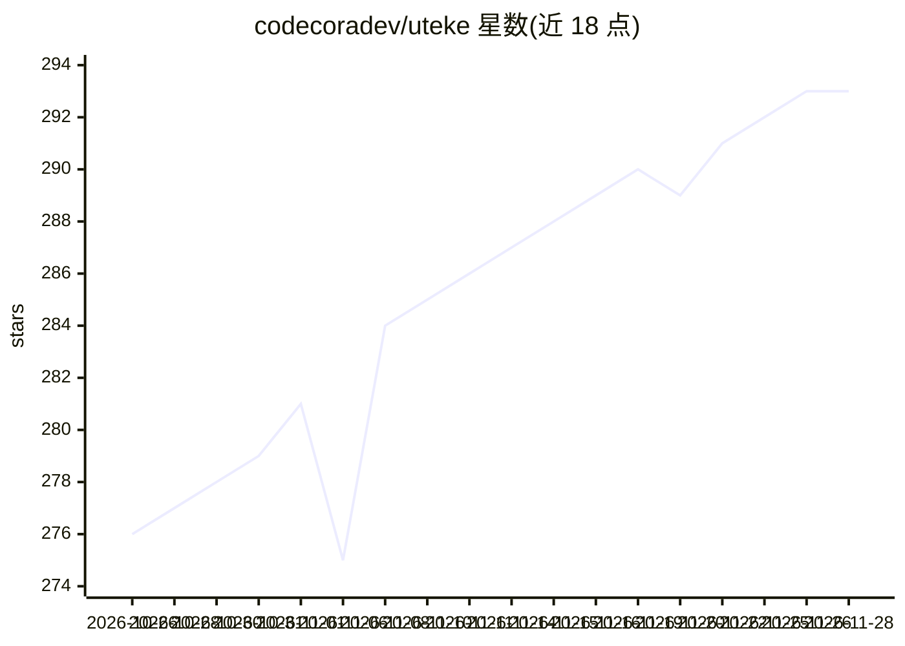

# codecoradev/uteke

⭐ 293 · Rust · Apache-2.0 · 推送 2026-11-27 · [GitHub](https://github.com/codecoradev/uteke) · [官网](https://uteke.app) · 组织维护

**给 AI agent 提供长期记忆的 MCP 服务器，本地离线运行**

单个 Rust 二进制实现的 agent 长期记忆存储：通过 MCP（stdio 或 Streamable HTTP）供 Claude Code、Cursor、Codex 等 agent 客户端读写记忆。检索采用本地向量 + SQLite FTS5 全文融合（RRF），无 LLM 调用、无 API key，约 45ms 温启动查询；支持 Rooms 多 agent 共享记忆与作者归属、时间点回溯、关系图、衰减与加密信息掩码。README 报告 LongMemEval-S recall@5 98.2%，原始输出与复现脚本随仓库提供。可自托管（Apache-2.0）或使用 Uteke Cloud（开放 beta 免费托管版）。

## 筛选速览

| 维度 | 判定 | 备注 |
|---|---|---|
| AI 角色 | `ai-ecosystem` | LLM/agent 周边工具 |
| 许可风险 | `permissive` | Apache-2.0 |
| 部署形态 | `self-host` | docker 或自建部署 |
| 模型依赖 | — | README 未给出锁定关系 |
| 硬件要求 | `cpu-ok` | |
| 安装摩擦 | `low` | 无编译、无系统依赖或容器化 |
| 成熟度 | — | 结构信号不足 |

## 能力要点

- 本地嵌入 + 全文检索融合，检索路径零 LLM 调用，CPU 即可运行
- MCP 服务器支持 stdio 与 Streamable HTTP 两种传输
- Rooms 多 agent 共享记忆，带作者归属与时间点回溯（--at）
- 单一 Rust 二进制，无 Python/向量数据库/API key 依赖

## 适用场景

- 让 Claude Code 或 Cursor 在多次会话间保留部署偏好等项目知识
- 团队多个 agent 共享同一份工程决策记忆并区分记录者
- 需要数据不出本机的本地 agent 记忆方案

## 场景标签

`Agent 记忆` · 领域:Agent 开发

## 证据(README 行号)

> L5:  Long-term memory for any AI agent.
> L6:  One Rust binary, runs offline, no API key. Self-host it free, or let us host it on Uteke Cloud.
> L40: { "mcpServers": { "uteke": { "command": "uteke-mcp" } } }
> L147: |**Any MCP client**|stdio (`uteke-mcp`) or Streamable HTTP (`uteke-serve`) · transports|

## 星数曲线

2026-10-26 276 → 2026-11-28 293（+17）

---
*卡片 v1 · prompt 1.4 · 生成 2026-11-27 · 置信度 high · 依据 README sha `a1db37376bb1` · [字段定义](../../DATASET.md)*
