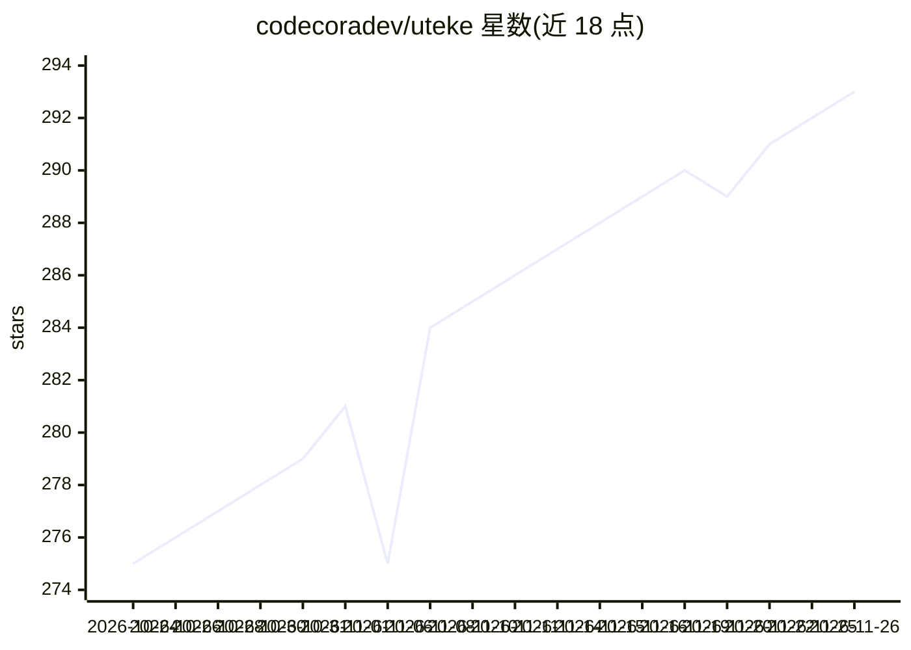

# codecoradev/uteke

⭐ 293 · Rust · Apache-2.0 · 推送 2026-11-25 · [GitHub](https://github.com/codecoradev/uteke) · [官网](https://uteke.app) · 组织维护

**给 AI agent 提供本地长期记忆的 MCP 服务**

以单一 Rust 二进制交付的 agent 长期记忆存储：通过 MCP server（stdio/HTTP）供 Claude Code、Cursor、Codex 等客户端读写共享记忆，检索路径为本地向量加 SQLite FTS5 融合排序，零 LLM 调用、离线运行、无需 API key，首次运行下载约 200MB 嵌入模型。提供 Rooms 多 agent 共享、时间点回溯、衰减与去重维护。限制：Windows 需用 PowerShell 脚本安装；基准数字来自其自测流程，评测设置与其他项目不完全可比（README 脚注已声明）。

## 筛选速览

| 维度 | 判定 | 备注 |
|---|---|---|
| AI 角色 | `ai-ecosystem` | LLM/agent 周边工具 |
| 许可风险 | `permissive` | Apache-2.0 |
| 部署形态 | `self-host` | docker 或自建部署 |
| 模型依赖 | — | README 未给出锁定关系 |
| 硬件要求 | `cpu-ok` | |
| 安装摩擦 | `low` | 无编译、无系统依赖或容器化 |
| 成熟度 | — | 结构信号不足 |

## 能力要点

- 检索路径零 LLM 调用，本地向量+FTS5 融合排序，~45ms 温态查询
- Rooms 多 agent 共享记忆，带作者归属与跨 agent 回忆
- 时间点回溯（--at）、关系图、衰减、Dream Cycle 维护
- Self-host（Apache-2.0）与 Uteke Cloud 托管两种运行方式

## 适用场景

- 让 Claude Code/Cursor/Codex 多个 agent 共享同一份长期记忆
- 本地敏感数据场景下自托管 agent 记忆
- 对话结束后 agent 仍能回忆早期部署偏好或决策

## 场景标签

`Agent 记忆` · 领域:Agent 开发

## 证据(README 行号)

> L40: { "mcpServers": { "uteke": { "command": "uteke-mcp" } } }
> L147: |**Any MCP client**|stdio (`uteke-mcp`) or Streamable HTTP (`uteke-serve`) · transports|
> L204: |🔌 **MCP Server**|JSON-RPC over stdio + Streamable HTTP. Works with Claude Code, Cursor, Hermes.|

## 星数曲线

2026-10-24 275 → 2026-11-26 293（+18）

---
*卡片 v1 · prompt 1.4 · 生成 2026-11-25 · 置信度 high · 依据 README sha `f9c75e1ea94e` · [字段定义](../../DATASET.md)*
