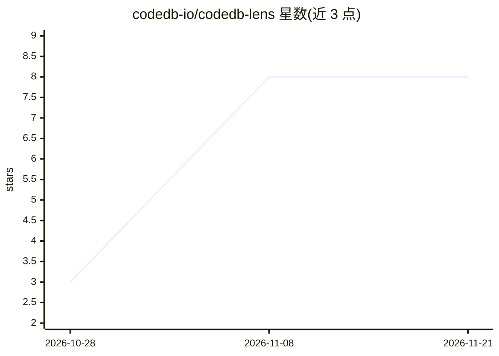

# codedb-io/codedb-lens

⭐ 8 · Go · Apache-2.0 · 推送 2026-11-06 · [GitHub](https://github.com/codedb-io/codedb-lens) · [官网](https://app.codedb.com.br/lens?utm_source=github&utm_medium=repo) · 组织维护

**SQL Server 与 PostgreSQL 只读健康检查 CLI 工具**

以只读登录连接数据库实例，按规则目录运行检查（v0.8 含 26 条规则加 8 条录制规则），生成自包含的 HTML+JSON 报告，附 A–F 评级与覆盖率标记。每条发现附采集值、产生查询与置信级别（Confirmed/Hint/No data）。规则为 YAML+SQL 文件形式。提供 Windows 安装包/Scoop、Linux .deb/.rpm/tarball 与 Docker 运行方式，应用与报告支持英语和巴西葡萄牙语。

## 筛选速览

| 维度 | 判定 | 备注 |
|---|---|---|
| AI 角色 | `ai-enhanced` | 去掉 AI 部分产品仍成立 |
| 许可风险 | `permissive` | Apache-2.0 |
| 部署形态 | `self-host` | docker 或自建部署 |
| 模型依赖 | — | README 未给出锁定关系 |
| 硬件要求 | — | 无带数字的原话,不猜 |
| 安装摩擦 | `low` | 无编译、无系统依赖或容器化 |
| 成熟度 | — | 结构信号不足 |

## 能力要点

- 只读检查：无 DDL/DML、无服务器端 agent，数据不出本机
- A–F 评级报告与覆盖率标记，发现附带证据查询
- codedb-lens mcp 提供只读 MCP 服务器，供 Claude/Copilot/Cursor 等 AI 客户端调用
- record + report 可对实例持续观察至 24 小时

## 适用场景

- 上线前对 SQL Server/PostgreSQL 实例做一次性健康检查
- 把数据库诊断接入 Claude Desktop 或 Cursor 等 AI 客户端
- 用 record 模式对生产实例观察一段时间后生成报告

## 场景标签

 · 领域:数据库运维/诊断

## 证据(README 行号)

> L4:  Free, read-only health check for SQL Server and PostgreSQL .
> L83: Ask Claude, GitHub Copilot or Cursor about your database. `codedb-lens mcp` is a read-only MCP server that your AI

## 星数曲线

2026-10-28 3 → 2026-11-21 8（+5）

---
*卡片 v1 · prompt 1.4 · 生成 2026-11-20 · 置信度 high · 依据 README sha `f7504477c668` · [字段定义](../../DATASET.md)*
