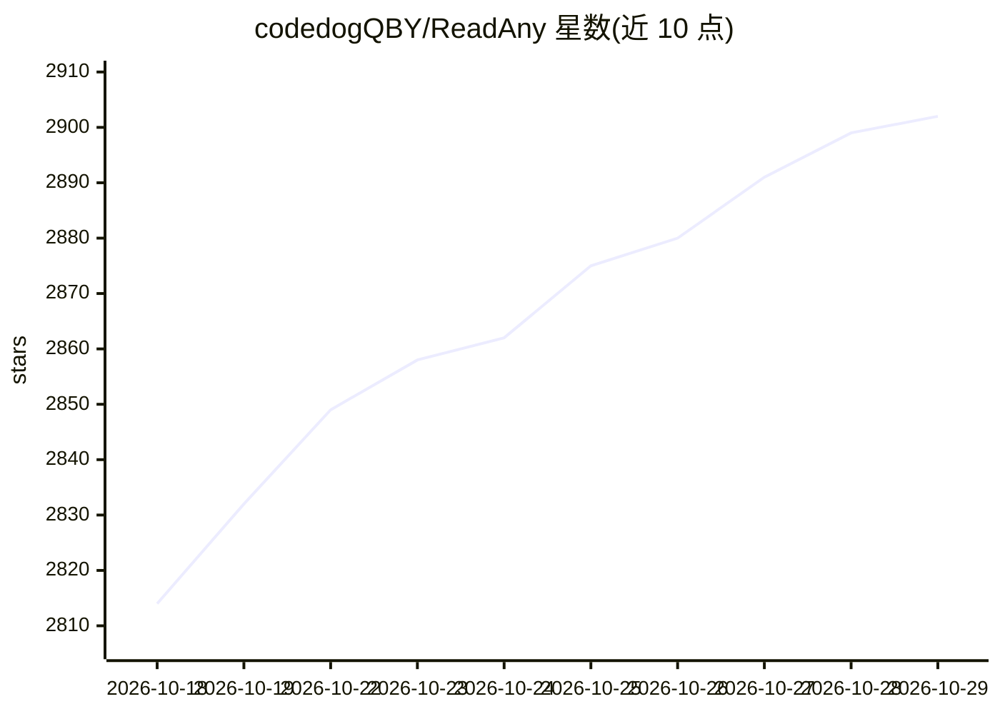

# codedogQBY/ReadAny

⭐ 2,902 · TypeScript · NOASSERTION · 推送 2026-10-07 · [GitHub](https://github.com/codedogQBY/ReadAny) · [官网](https://codedogqby.github.io/ReadAny/) · 个人维护 · 中文 README

**本地优先的跨平台 AI 电子书阅读器，支持语义搜索与 RAG 对话**

面向桌面（Tauri 2 + React）与移动端（Expo/React Native）的电子书阅读器，支持 EPUB/PDF/MOBI/AZW3 等 10+ 格式。AI 功能包括基于书籍上下文的 RAG 对话、向量+BM25 混合语义搜索、AI 翻译与内置技能系统；嵌入与向量库在本地运行，可接入 OpenAI/Claude/Gemini/Ollama/DeepSeek 等模型。另提供五色高亮、Markdown 笔记、多格式导出、TTS、阅读统计与 WebDAV 跨设备同步。AI 配置为可选项，阅读功能可脱离 AI 使用。

## 筛选速览

| 维度 | 判定 | 备注 |
|---|---|---|
| AI 角色 | `ai-enhanced` | 去掉 AI 部分产品仍成立 |
| 许可风险 | `none` | NOASSERTION |
| 部署形态 | `desktop` | 安装包/桌面程序 |
| 模型依赖 | local-ok | 支持本地模型 |
| 硬件要求 | — | 无带数字的原话,不猜 |
| 安装摩擦 | `low` | 无编译、无系统依赖或容器化 |
| 成熟度 | — | 结构信号不足 |

## 能力要点

- RAG 对话回答基于当前书籍上下文并定位来源
- 向量检索 + BM25 混合语义搜索
- 本地嵌入与本地向量库，离线可用
- 支持 OpenAI/Claude/Gemini/Ollama/DeepSeek 等多种模型接入

## 适用场景

- 读书时向 AI 提问并按语义而非关键词查找书中内容
- 高亮批注并导出到 Obsidian/Notion 等工具
- 多设备间通过 WebDAV 同步书库、高亮与笔记
- 用 TTS 朗读书籍内容

## 场景标签

`文档问答` `语义搜索` `语音合成` · 领域:内容生成

## 证据(README 行号)

> L29: - **Chat with your library** - Ask questions about the current book or selected passages, with answers grounded in 
> L164: 3. **Configure AI** (Optional) - Settings → AI → Enter API Key
> L31: - **Keep knowledge private** - Local embeddings and a local vector store keep your books, highlights, and notes off

## 星数曲线

2026-10-18 2,814 → 2026-10-29 2,902（+88）

---
*卡片 v1 · prompt 1.4 · 生成 2026-10-21 · 置信度 high · 依据 README sha `d03176df9d10` · [字段定义](../../DATASET.md)*
