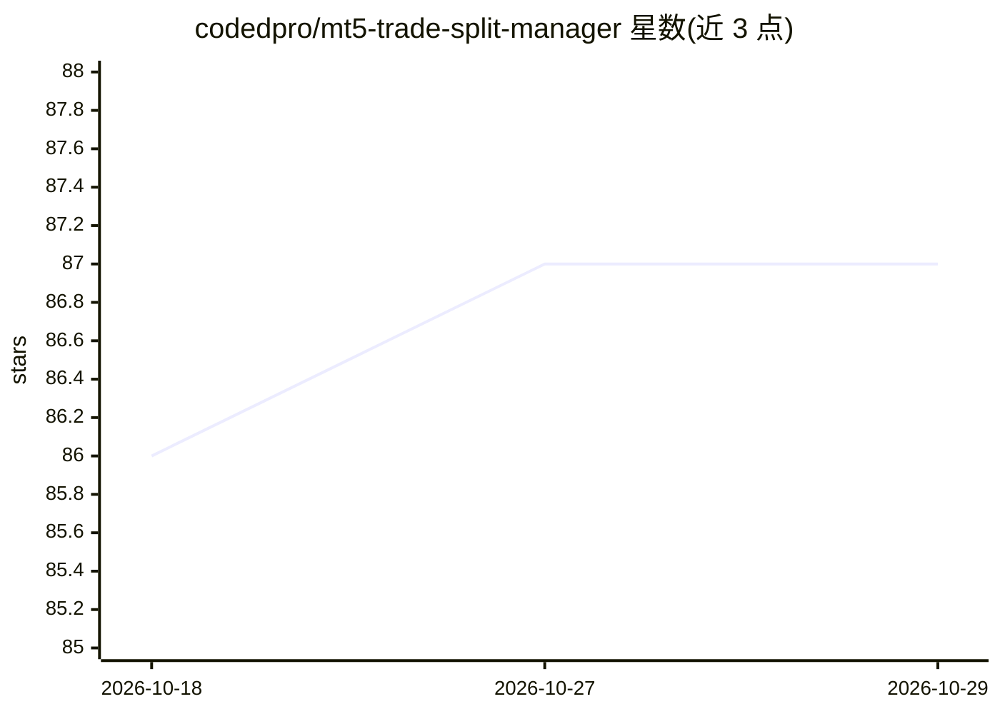

# codedpro/mt5-trade-split-manager

⭐ 87 · MQL5 · NOASSERTION · 推送 2026-07-06 · [GitHub](https://github.com/codedpro/mt5-trade-split-manager) · 组织维护

**MT5 智能下单 EA：拆分订单+移动止损，配 REST API 与 MCP 供 AI Agent 调用**

MetaTrader 5 Expert Advisor，将单笔订单拆分为 1-10 个仓位（默认 5 档 60/10/10/10/10），TP2 达成后自动将止损移至保本位，支持安全关机模式与每日亏损限制。架构为 FastAPI 服务器通过 TCP Socket 与 MT5 EA 通信，对外提供 REST API 与 MCP 服务器，供 Claude 等 AI Agent 以 JSON 端点解析交易信号并下单。支持任意 MT5 品种（黄金/白银为示例），订单类型与 SL/TP 方向按实盘校验并拒绝错误方向。运行需 MT5 终端与 Python 3.8+。

## 筛选速览

| 维度 | 判定 | 备注 |
|---|---|---|
| AI 角色 | `ai-enhanced` | 去掉 AI 部分产品仍成立 |
| 许可风险 | `permissive` | NOASSERTION |
| 部署形态 | `self-host` | docker 或自建部署 |
| 模型依赖 | locked-api |  |
| 硬件要求 | — | 无带数字的原话,不猜 |
| 安装摩擦 | `low` | 无编译、无系统依赖或容器化 |
| 成熟度 | — | 结构信号不足 |

## 能力要点

- 单笔订单拆分为 1-10 个仓位，支持自定义 volume_split 数组
- TP2 触发后自动移动止损至保本位的安全追踪逻辑
- FastAPI REST API + TCP Socket 与 MT5 EA 通信
- 内置 MCP 服务器供 Claude Code / Claude Desktop 直接操控 MT5

## 适用场景

- 把交易信号接入 AI Agent，用自然语言下单管理 MT5 仓位
- 通过 REST API 做程序化的多档止盈下单
- 离场前用安全关机模式保护未触发追踪止损的仓位

## 场景标签

`金融量化` · 领域:学习与行业

## 证据(README 行号)

> L11: **🤖 AI-Agent Friendly** | **Professional-grade MetaTrader 5 Expert Advisor with intelligent order splitting, automa
> L38: - ✅ **MCP Server** - Native Model Context Protocol server so Claude Code / Claude Desktop can inspect and control M

## 星数曲线

2026-10-18 86 → 2026-10-29 87（+1）

---
*卡片 v1 · prompt 1.4 · 生成 2026-10-24 · 置信度 mid · 依据 README sha `f94531bc5e1c` · [字段定义](../../DATASET.md)*
