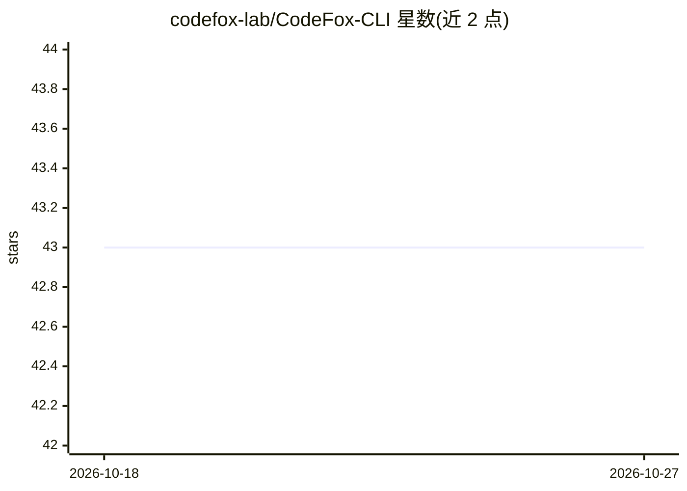

# codefox-lab/CodeFox-CLI

⭐ 43 · Python · MIT · 推送 2026-03-22 · [GitHub](https://github.com/codefox-lab/CodeFox-CLI) · [官网](http://code-fox.online) · 组织维护

**面向 git diff 与 CI 的命令行 AI 代码审查工具**

CLI 优先的 AI 代码审查工具：读取 git diff，检索相关项目上下文，将审查请求发送到所配置的模型，在终端或 CI 流水线中输出审查评论与修复建议；支持可配置的审查侧重点（security/performance/style）。后端可用本地 Ollama 或云端 LLM（Gemini、OpenRouter），提供 .codefoxignore 与 .codefox.yml 配置文件，集成 GitHub Actions 与 GitLab。README 声明其不是 Cursor/Claude Code 一类的 IDE 编码助手，定位为 diff 审查工作流。

## 筛选速览

| 维度 | 判定 | 备注 |
|---|---|---|
| AI 角色 | `ai-native` | 本体是模型或模型工具 |
| 许可风险 | `permissive` | MIT |
| 部署形态 | `library` | 以包/库形式分发 |
| 模型依赖 | local-ok | 支持本地模型 |
| 硬件要求 | — | 无带数字的原话,不猜 |
| 安装摩擦 | `low` | 无编译、无系统依赖或容器化 |
| 成熟度 | — | 结构信号不足 |

## 能力要点

- 基于 git diff 并结合项目上下文生成审查评论与修复建议
- 支持本地 Ollama 与云端 LLM（Gemini、OpenRouter）双后端
- 可配置审查侧重点：security / performance / style
- GitHub Actions 与 GitLab CI 集成，.codefoxignore 排除文件

## 适用场景

- 提交前在终端快速审查自己的代码改动
- 在 PR 与 CI 流水线中自动生成 AI 代码审查
- 用本地 Ollama 模型做不上传代码的私有化审查

## 场景标签

`代码审查` · 领域:编码与开发

## 证据(README 行号)

> L20: **CodeFox-CLI** is a CLI-first AI code review tool for **git diffs, pull requests, and CI workflows**.
> L25: - **local reviews with Ollama** for self-hosted workflows
> L26: - **cloud LLM providers** such as Gemini and OpenRouter when remote inference is preferred

## 星数曲线

2026-10-18 43 → 2026-10-27 43（+0）

---
*卡片 v1 · prompt 1.4 · 生成 2026-10-25 · 置信度 high · 依据 README sha `56083d52fb49` · [字段定义](../../DATASET.md)*
